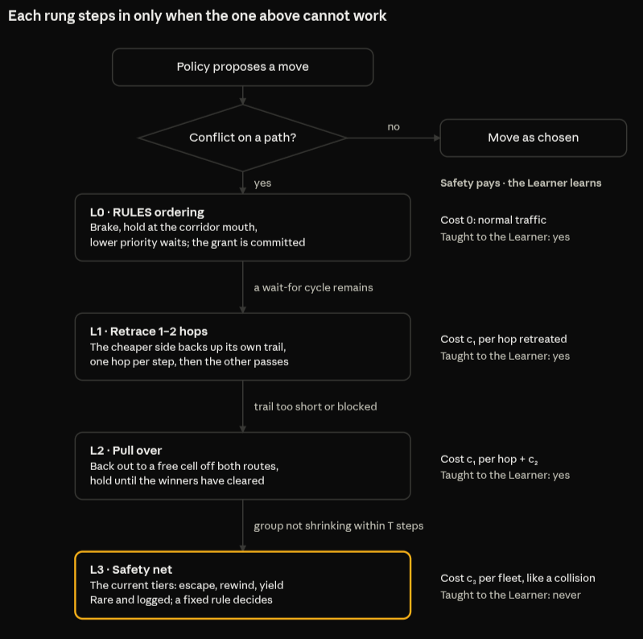

# FLOWRRA v2 — The Conflict Ladder

Rohit Tamidapati · 5 October 2026 · updated 6 October 2026

> **Status, 11 October 2026.** Steps 1–3 are built and tested, and runs 2–4 are complete. **The v2 champion is run 2's checkpoint: the ladder and rung costs, with no Learner.** In a seeded re-run of the shock benchmark it beat run 4 (the bounded Learner) on all five pre-registered small-map measures. On the large map it matches RULES alone and beats RHCR-PIBT + naive by 14 points of recovered orders, losing 60% fewer rescuers. The Learner stays in the code, switched off. The benchmark is now seeded per instance, after the same checkpoint scored 65.5% and 70.6% in two unseeded runs. People now share the floor (debris that a human comes to clear), orders can come from a fixed order book (the same work every episode, whatever the fleet count), and **run 5 (warm_stream1)** put the champion back to work with both, still learning: 4 of 6 predictions passed. People finished every job in all 50 episodes and deliveries held, but learning on the job made the fleet faster and slightly less safe, so run 2's checkpoint stays the champion until a frozen, like-for-like test (`deploy_eval.py`; built, predictions written, running now) says otherwise. The build log at the end records each step and what its runs showed.

## Why

The late storms in teacher\_run1 were not crashes: they were two controllers fighting over the same fleets, and neither looked at paths. Collisions stayed under 1 per episode late in the run; recoveries reached 249 in episode 110.

What the 115 episodes showed:

- **The recovery head became a coin flip.** Its value errors grew to about 2, while a needless ask costs about 0.06. It asked for recovery 69–458 times an episode with nothing at risk, and its preemptions cleared fleets 3–5% of the time, down from 30–50%. aws\_run4 shows a milder version (errors about 0.4, 77 wasted asks) without any teacher.
- **Holds locked RULES out.** RULES' action applies only to a fleet that is not held. In storm episodes, hold overrides outnumbered RULES overrides 5–12 to 1; in healthy ones RULES led about 5 to 1.
- **The tiers do not look at paths.** Tier 1 moves a fleet one cell by density, Tier 2 rewinds positions, Tier 3 picks the fleet closest to its goal. The fleets then steer back along the same converging routes.
- **Fairness without commitment livelocked.** Between fleets 7 and 73 in episode 110 the winner changed 30 times in 31 decisions. Each win lasted one 5-step hold, so neither got through.
- **The margin teacher drifted the values.** It pushed down moves that are never executed, so nothing pulled them back up; `qval_safety` fell from 0.0 to −6.6 while real safety penalties shrank.
- **A padding bug** fed dummy fleets into the recovery head's view of the floor in training. Fixed in step 1 (masked pooling).

## Principles

One ladder of path-aware RULES moves replaces the position-based tiers, and each learned head does one job.

1. **Three jobs in three heads.** Safety, Delivery and Efficiency forecast consequences. A Learner head learns RULES' judgement and speaks only inside conflicts. When the ladder itself fails, a fixed rule steps in (L3); the learned recovery head is parked. They combine only at choice time.
2. **RULES are the tiers.** Every intervention is a RULES move, chosen from the routes the fleets intend, not from where they stand.
3. **Freedom first.** A fleet moves as its policy chooses until its move conflicts on a path. The ladder steps in early, not after a crash.
4. **Physics.** Every move happens at driving speed, retreats included: half a cell per step, so one hop takes two steps. No jumps.
5. **Commitment.** Once a fleet is granted passage, it keeps it until it has cleared the conflict.
6. **Pay by consequence.** A fleet pays for the rung its move made necessary, never for following a rule.
7. **Values stay honest.** Nothing but real rewards ever moves a Q-value.

## Definitions

Five objects, all built from what the code already computes.

| Term | Meaning | Already in the code |
| --- | --- | --- |
| Route πᵢ | The next H = 8 cells fleet *i* intends, one set per step (ties branch) | `density._intended_path`, used by path warnings |
| Conflict group | Fleets whose routes meet within the horizon, joined transitively | Union-find in the simultaneous step |
| Wait-for graph W | An arrow *i → j* when *j* holds, or is committed to, a cell on πᵢ before *i* reaches it | Pair labels in `conflict_warehouse.py` (`head_on`, `blocked`, `following`, `contested`) |
| Retreat distance rᵢ | Hops *i* must reverse along its own trail until it is off every route in its group | New: trail = last positions, kept per fleet |
| Priority key | hops to goal − 0.25 × steps waited, then seniority, then a fixed tie-break | `ConflictRules.key` |

The key fact behind the ladder is standard in deadlock theory: **a group whose W has no cycle resolves by waiting alone; only a cycle needs someone to retreat.** Waiting never resolves a cycle, so at least one fleet in it must physically back up.

## Classification

Every conflict group is sorted by its size and the shape of its wait-for graph; that alone decides the lowest rung that can work.

| Group | Path label | Wait-for graph | What resolves it | Rung |
| --- | --- | --- | --- | --- |
| 2 fleets | following | one arrow, gap steady or growing | Braking only | L0 |
| 2 fleets | following, gap closing | one arrow | Brake the follower | L0 |
| 2 fleets | contested (one shared cell) | a chain A → B | Ordering: the lower key waits | L0 |
| 2 fleets | blocked (one is stationary) | a chain A → B | Wait; if the blocker is dead, route around (yield to stopped) | L0 |
| 2 fleets | head-on, at a corridor mouth | would become A ⇄ B | Corridor-entry hold: the entering fleet waits outside | L0 |
| 2 fleets | head-on, already committed | a 2-cycle A ⇄ B | One fleet retreats | L1 or L2 |
| 3+ fleets | any, no cycle | a chain or tree | Ordering, leaders first (topological order) | L0 |
| 3+ fleets | any, with cycles | one or more cycles | One retreat per cycle, then ordering | L1 or L2 |

Two-fleet conflicts are the common case and are fully covered by rules that already exist, except the 2-cycle outside a corridor. Multi-fleet conflicts are new territory: today they fall straight to the position-based tiers.

For 3+ fleets with cycles, the fewest-retreats choice is a feedback-vertex-set problem, which is hard in general. Groups here hold 2–5 fleets, so trying every option is cheap; above 6 fleets, break each cycle at its cheapest member, one cycle at a time.

## The ladder

Four rungs, each tried only when the one above cannot resolve the group; ordinary traffic never leaves L0.

<div align="center"> 
   <br></br>
</div>

In the drawing, "one hop per step" means one hop at a time: fleets drive half a cell per step, so each hop takes two steps.

The triggers between rungs are structural (a cycle, a blocked trail, no progress in T steps), never a learned head's guess. Only L3 uses today's tiers, and Tier 2 stays there as the last resort.

## Rules

Four rules decide every rung: who retreats, how long a grant lasts, how waiting is rewarded, and who outranks whom.

**Who retreats: the cheapest retreat, not the furthest from goal.** If side A backs out, the cost is about twice its retreat (out and back) plus the time for B to pass; B barely waits. A side is the fleet and every fleet following it, as in today's corridor back-out. So retreat the side with the smaller total:

```math
R(S) = \sum_{f \in S} r_f, \qquad \text{retreat } \arg\min_{S \in \{A, B\}} R(S)
```

Ties go by priority key, then the fixed tie-break. Example: A is one hop outside a junction, B is inside the corridor heading out. R(A) = 1, R(B) ≥ 2, so A steps back one hop and B comes out.

**Commitment.** A grant holds until the conflict it settled is over: no member is still head-on with the fleet that gave way, or racing it for the same cell. A convoy or a queue that remains is left to braking and the queue rules, which are built for it. *Corrected 6 October 2026: the first version held until the two routes shared no cell at all. In a harmless convoy they keep sharing cells, so retreating fleets stayed parked and blocked others; in retrace_run2's first episode, blocked pairs tripled.* No new decision is made on that pair while a grant stands. Today's corridor retreat orders already work this way; the recovery tiers' alternation rule does not, which is what looped 7 and 73.

**One grace check before a retreat.** A cycle is spotted from routes up to 8 cells ahead, so it starts as a standoff, not a crash. On first detection, L0 holds both sides and their policies get one chance to break it; if the cycle is still there at the next check, L1 acts. A fleet that backs off on its own pays no rung cost, so Safety learns that resolving early is free. Exception: a cycle first spotted with the fleets already adjacent goes straight to L1.

**Aging, per conflict.** Every step a fleet is made to wait raises its priority by 0.25 hops, but only within its current conflict: the count resets once the fleet has been out of every warned pair for 3 steps. Aging exists to stop starvation inside a conflict. Carried across a whole trip, as today (reset only on delivery), an old wait lets a fleet outrank one a cell from its goal in an unrelated conflict. Without it, the fleet that clears soonest goes first, which minimises total waiting.

**Precedence.** From highest to lowest:

1. L3 safety-net actions (rare, only after the ladder has failed)
2. Ladder orders: retreats, pull-over holds, corridor holds, ordering waits
3. The fleet's own policy

A recovery hold never silences a ladder order. Holds themselves become ladder orders, so there is one authority in a warning zone instead of two. This removes the `and not _held` lock-out in `core_warehouse.py`.

## Why it terminates

With commitment and aging, a conflict group of n fleets clears within n grants, and no fleet waits forever. A sketch, to be turned into tests:

1. **No cycle.** Order the group by W (leaders first). The leader's next cell is free of the group, so it moves. Each committed grant ends with that fleet past every route it met, so the group shrinks by at least one.
2. **Cycle.** At least one fleet per cycle retreats along its own trail. The trail is cells it occupied, so those cells were reachable, and reversing frees the cell the next fleet in the cycle needed. The cycle becomes a chain, which step 1 clears.
3. **No starvation.** A waiting fleet's key falls by 0.25 per step, so after a bounded wait it outranks every competitor it can still meet.
4. **No livelock.** A grant cannot be reversed mid-passage (commitment), so the 7/73 pattern, winner changing every decision, cannot occur.

Where the argument can fail, and what catches it:

- A retreat trail is blocked, because another fleet is now standing on it. Then try the other side of the cycle.
- Both sides are blocked, or a group fails to shrink within T steps. Then fall to L3 and log it.
- A dead (failed) fleet sits on a trail. Dead fleets are fixed obstacles and are never part of a cycle; they route the live fleets around.

## The three heads

Each head has one job and one training signal, and only the choice step combines them.

| Head | Its job | Trained by | Used where |
| --- | --- | --- | --- |
| Safety, Delivery, Efficiency | Forecast the consequences of a fleet's own move | TD on real rewards only | Choice: weighted sum 6 : 4 : 1, as today |
| Learner (new, step 3) | Learn RULES' judgement: what the ladder would do here | Supervised, on every L0–L2 decision | Choice only, and only for a fleet inside a conflict group: its preference is added with weight β. Silent in free traffic, where it was never taught. Never inside a Q-value or a target |
| Recovery | Decide when the ladder has failed | TD on the holon signal; frozen while the ladder runs | Parked: L3 is a fixed rule. If L3 proves common, it can learn when to fire L3 and which tier, acting only if Q(act) − Q(none) > δ |

**Safety pays by rung.** Costs are charged to the fleets the event involved, through the per-fleet ledger that already runs in shadow mode:

| Rung | What happened | Safety cost |
| --- | --- | --- |
| L0 | Ordering, braking, corridor hold | 0 (normal traffic) |
| L1 | Retraced 1–2 hops | c₁ per hop retreated |
| L2 | Retreat to a pull-over cell | c₁ per hop + c₂ |
| L3 | Safety net fired | c₃ per fleet involved, about one collision |

Calibrated against the existing safety terms (fatal collision −50, worst warning step −1.2, both raw): **c₁ = −2.4 per hop**, because one hop takes two steps at half speed, so giving way costs what lingering in the worst warning would for the same time; **c₂ = −6** extra for leaving a corridor for a bay; **c₃ = −50**, what a collision costs. Each escalation is charged once, when it happens. All four values are settings (`training.rung_costs`), open to a paired dry run. Paying the retreating fleet only would punish the fleet that solved the conflict, so every fleet in the group shares the cost. The share is weighted by path: fleets in the conflict group pay 1.0, fleets whose route heads into the conflict's cells pay 0.25, and everyone else pays 0. Distance alone would charge bystanders, such as a fleet parked nearby or driving away. A fleet that routes itself around a jam pays nothing, so the cost teaches good routing, not just escaping.

**Recovery head: frozen under the ladder, with two fixes ready if it returns.** If unfrozen, it acts only when "act" beats "none" by a margin δ larger than its value noise, so a coin flip defaults to doing nothing. And it gets its own small encoder over the fleets' raw features, so the fleet heads' drift cannot change what it sees. A stop-gradient alone would not do this: it only stops the recovery head from disturbing the shared trunk, not the trunk from disturbing it.

## What happens to the teacher

The margin teacher is retired; its idea continues as the Learner head: the ladder teaches, the Learner learns, and a paired test decides whether that head earns its place.

- **Why Safety alone is not enough.** With the ladder, Safety pays only for escalations, so it learns what to avoid. L0 ordering costs nothing, so Safety has no reason to learn it, and RULES would stay as permanent traffic control. That is most of RULES' everyday judgement, and the policy would never absorb it.
- **Why both, not one.** The Learner learns what RULES would do here: dense, fast, but capped at RULES' level. Safety learns what happens if I do this: slower, but it is how the policy can beat RULES, by avoiding conflicts upstream before the ladder ever acts. The Learner speaks only inside a conflict group, where it has been taught; in free traffic the three consequence heads decide alone, so it never interrupts the flow.
- **The bleeding, made measurable.** As the Learner's agreement rises, RULES overrides fall. The override rate across training is the number that shows RULES moving into the policy.
- **The margin switch** (`training.teacher_margin.enabled`) stays in the code, set to off, so teacher\_run1 can be reproduced. Its write-up records it as tried and replaced, with the reason: it pushed on values that no experience could correct.
- **The test.** First the ladder and Safety costs with the Learner off; then the same run with the Learner on. If L0 overrides do not fall, the Learner head is not doing its job.

**Ladder context: letting fleets see the ladder.** The Learner can only learn a back-off if a fleet can tell it is in a situation that needs one, and today its observation cannot show that waiting will not help. Step 3 adds four signals to every fleet's observation. All four are knowable from its neighbours' broadcasts, so nothing becomes central.

| Signal | What it tells the fleet | Values |
| --- | --- | --- |
| In a cycle | Waiting alone cannot resolve my conflict | 0 or 1 |
| Steps in this conflict | How long my group has been stuck | Count, divided by T |
| Group's rung | How far the ladder has escalated | L0–L3, one-hot |
| Cheaper side to back out | My side's retreat cost against the other side's | Ratio; below 1 means my side is cheaper |

With these, the reflex becomes learnable from a fleet's own view, the way a good driver reads the road: facing another fleet in a single lane, closer to the junction, so reverse now, before the ladder has to order it. A back-off that starts before any ladder order also costs nothing (the grace check), so Safety rewards the same reflex the Learner copies. The signals enlarge the network's input, which v2 can absorb because it trains from scratch.

Tracked: **self-initiated back-offs**, where a fleet reverses with no ladder order. As the reflex forms, they rise while RULES-ordered retreats fall.

**Pair relations on the attention connections.** The four signals summarise a fleet's situation; the pairwise picture they come from can go into the network too. Graph attention already carries 4 numbers on each neighbour connection (`edge_dim=4`). Step 3 adds each pair's path-awareness label to that connection, so every fleet sees, neighbour by neighbour, how that neighbour relates to it:

| Relation | What it tells the fleet |
| --- | --- |
| head-on | Each route runs into the other: one of us must give way |
| contested | We reach the same cell at about the same time |
| blocked | My route runs into a neighbour standing still, or theirs into me |
| following | Same direction, one behind the other |
| wait direction | Whether I wait for this neighbour, it waits for me, or neither |

As numbers, that is a one-hot over the four kinds plus the wait direction, a handful of extra values per connection. It stays decentralised: each label comes from two neighbours' broadcast routes, exactly what the orchestrator already computes for the wait-for graph.

## Build order, switches and tests

Three steps, each behind its own switch and each off by default, so a run with every switch off reproduces today exactly.

| Step | What lands | Switch | Its own test |
| --- | --- | --- | --- |
| 1 (done) | Masked pooling for the graph-level heads | none: a bug fix | `test_graph_pooling.py` |
| 2a (done) | Ladder: one authority (no hold lock-out), wait-for graph, retreat by cheapest side, grace check, commitment, retrace one hop at a time at driving speed | `conflict.ladder` (`shadow`, `retrace`) | `test_ladder_authority.py`, `test_ladder_shadow.py`, `test_ladder_retrace.py` |
| 2b | Recovery head frozen under the ladder (done); margin δ and its own encoder only if it is unfrozen later | `conflict.ladder` (freezes it) | `test_recovery_frozen.py` |
| 2c (done) | Safety pays by rung, weighted by path | `training.rung_costs` | `test_rung_costs.py` |
| 3 (done; off in the v2 champion, build log 21) | Learner head, silent outside conflict groups, and the ladder-context signal in every fleet's observation, plus pair relations on the attention connections | `training.learner` | `test_learner_head.py` |

The run plan:

1. Paired dry runs per switch (2 episodes, seed 0, same instances, switch off vs on), as with the teacher margin.
2. One long run with 2a, 2b and 2c on and the Learner off, on all\_scens\_v5, both maps, 25/40/60 fleets.
3. The same run with the Learner on. The difference between 2 and 3 is the Learner head's contribution.
4. The frozen shock benchmark, with every arm re-run on the new code. RULES alone is re-run too, because the ladder changes RULES.

## Measurements and predictions

Each prediction is written before the runs and judged against teacher\_run1 on the same metric; a miss gets reported, not reworded.

| Prediction | teacher\_run1 (late) | Pass if |
| --- | --- | --- |
| Endgame loops end | max repeats per pair: 70 | ≤ 3 in every episode |
| No flip-flopping | winner changes per pair: 30 in 31 | ≤ 1 per pair per conflict |
| The ladder resolves conflicts itself | recoveries: 51 per episode | L3 fires < 2 per episode |
| The recovery head stops coin-flipping | wasted asks: 69–458 per episode | < 10 per episode |
| Values stay honest | qval\_recovery −15, qval\_safety −6.6 | both within ±1 for the whole run |
| Delivery holds | completion 97–99% | ≥ 97% in every 20-episode block |
| Safety holds | collisions under 1 per episode | no worse |
| Bleeding (run 3 only) | not measured | L0 overrides fall across training, while the Learner's agreement rises; self-initiated back-offs rise as RULES-ordered retreats fall |
| The verdict | policy + RULES 67–70% vs RULES 85–87% | on the re-run shock benchmark, policy + RULES ≥ RULES alone |

New counters the CSV needs: rung per intervention (L0–L3), retreat hops, grant flips per pair, groups by size and cycle count, time-to-clear per group, self-initiated back-offs (a fleet reverses with no ladder order), the four ladder-context signals, and why each retrace order timed out (reached its cell or not, whether the other fleet progressed, the pair's last relationship).

## Decisions

All six open questions are decided; δ and β take their values from paired dry runs.

- [x] **Recovery head at L3: a fixed rule first.** If a group has not shrunk within T steps, collapse. The learned head stays in the code, switched off, and every L3 event is logged; if L3 proves common, that data will train it. Training on denser maps just to make L3 common would defeat the ladder.
- [x] **Lifts: retrace allowed.** Edges are two-way, so a fleet can back up or down the way it came instead of going out, waiting and coming back in. A shaft of single-lane cells is a corridor, so the entry rule orders fleets at its mouth.
- [x] **Trail length: 8 cells,** the route horizon. Simple and light to compute.
- [x] **T, in steps: steps per hop × (2 × the group's largest retreat + one route length) + 10.** Fleets drive half a cell per step, so a hop takes 2 steps, and a 1-hop retreat gives T = 2 × (2 + 8) + 10 = 30. The same formula sets each retrace order's budget. *Corrected 6 October 2026: the first version counted hops as steps, and in retrace_run1, 6 of 22 retrace orders timed out while the other fleet was still passing at half speed.*
- [x] **δ and β.** δ sits above the recovery head's measured value noise, so a coin flip defaults to doing nothing. β starts small and is set by a paired dry run.
- [x] **Stream mode.** A fleet driving to its exit dock is a normal group member at full weight; at zero weight it would learn to push through on its way out. Once it has left the floor it drops out, and the group re-checks its cycles.

## Build log

Each step was built behind its own switch, tested, and run against the step before it on the same seed and the same 10 episodes (both maps, 25/40/60 fleets). Ten cold episodes are noisy: identical setups have swung from 12 to 24 collisions between reruns, so only large or consistent changes are read as effects.

1. **Step 1, masked pooling.** The recovery head averaged dummy padding rows into its view of the floor during training, but not when acting. Fixed; a padded state now gives exactly the live answer (`test_graph_pooling.py`).
2. **Step 2a-i, one authority.** The learned recovery head was switched off and L3 became a fixed rule (for now: a warned pair lasting 30 steps with neither fleet closer to its goal). Holds no longer silence RULES, and aging resets per conflict. In a paired dry run at 60 fleets, an episode that had 96 recoveries and 1,529 holds had 3 L3 calls and 2 holds instead.
3. **Step 2b, recovery head frozen.** Under the ladder its loss is left out of training, so its drifting values can no longer reach the trunk the fleet heads share (`test_recovery_frozen.py`). pooling_run1 had shown it drifts even without the teacher.
4. **Step 2a-ii, the shadow graph** (shadow_run1, measuring only). 79 wait-for cycles in 10 episodes: 97% two fleets facing each other, 59% cleared on their own within one check, 85% on corridor cells. RULES' yield-to-stopped guard steps aside from loops it cannot order; in the two episodes where it did, cycles lived 29 and 31 steps.
5. **Step 2a-iii (2a-iv folded in), retrace.** retrace_run1: longest cycle 31 → 8 steps, loops left by the guard 8 → 1, L3 fires 2 → 0. But 6 of 22 orders timed out.
   - *Fix 1, the budget in steps* (retrace_run2). The budget had counted hops as steps; fleets drive half a cell per step. Timeouts halved in the calm episodes, but the first, most exploratory episode cascaded.
   - *Fix 2, release when the conflict is over* (retrace_run3). Orders had waited for the two routes to share no cell, which a harmless convoy never satisfies. Now an order ends once nobody is head-on with the fleet or racing it for a cell. Result: all 49 orders released, 0 timeouts, longest cycle 6 steps, completion 99.4%, the best of the series.
6. **Step 2c, Safety pays by rung** (rung_run1). Safety's values stayed stable (−0.002 to 0.013), and no collision ever involved a retreating fleet: reversing does not cause contact. Collisions fell 24 → 10 and retreats needed 49 → 18, within run-to-run noise so far. To watch: L2 corridor back-outs carry 75% of all charges, and completion dipped in two episodes.

7. **Step 3a, the Learner head** (built and tested; first run with run 3). A small head reads the shared trunk but never trains it: its input is detached, and its gradients are clipped on their own, so it cannot even shrink the trunk's updates through a shared clipping limit (a leak `test_learner_head.py` caught in the first build). No Q-value can move because of it. It learns, by plain supervision, the action RULES chose on every RULES-decided step. At choice time it nudges only fleets inside a conflict: score = Q + β × its log-probability, with β = 0.3 to start. Off, no head is built, so older checkpoints still load. Also counted: **self-initiated back-offs**. With the Learner off, ladder_run1's network agreed with RULES about 20% of the time; that is the baseline step 3 should raise.

8. **Step 3b, ladder context** (built and tested). Seven values appended to every fleet's state: in a wait-for cycle; time in conflict (steps ÷ T, capped at 1); its group's rung (one-hot L0–L3, all zero outside a conflict); and whether its side is the cheaper one to back out (its retreat ÷ both sides', below 0.5 meaning it is). They are computed at the start of a step for the choice, and again after the move, from the same verdicts the reward uses, so a stored next state never carries the previous step's context. The state grows by 7, so runs with it on start cold. `state_layout()` now names the block, and it also gained the holon value it had been missing.

9. **The Learner's strength, β** (paired dry runs at 0, 0.1, 0.3 and 1.0). The Learner reached the same 82–89% agreement with RULES at every β; β only sets how often it overrides the consequence heads. At 1.0 it changed 77% of conflicted choices and cut self back-offs to a third, so the policy mostly copies RULES. At 0.3 it changed about a third, matched 1.0 on completion and collisions, and kept far more of the back-off reflex. **β = 0.3.**
10. **Step 3c, pair relations** (built and tested). Six numbers join the four already on each attention connection (closeness, path conflict, swap head-on, arrival order): head-on, contested, blocked or following from the path verdicts, plus "I wait for this neighbour" and "it waits for me", which swap when seen from the other side. Edge width 4 → 10, so runs with it on start cold.
    - *Found while building it:* the stored **next** state kept only the bare adjacency mask, so every value target was computed on a graph with no pairwise numbers, while every choice used them. That is the same train-versus-act mismatch as the padding bug, and it predates this work. Fixed behind `gnn.next_state_edge_features`, off by default so run 2 stays reproducible. It stays off for run 3 (see the ablation below), so run 3's difference from run 2 is step 3a + 3b alone.
    - *Also found, by the smoke test:* RULES and ladder orders, applied after the policy's obstacle check, could drive a fleet onto an obstacle. Every order must now be a valid move, or the fleet holds a step (`ladder_rule_orders_vetoed`).

11. **The step-3 ablation, which chose run 3's configuration.** Each piece was added one at a time, with everything else fixed: the ladder with shadow and retrace, rung costs, next-state edges off. Same seed, 5 episodes on the small map at 60 fleets. Each episode was cut at **300 steps, 3/8 of the 800 used in the long runs**, so completion here measures how far fleets got in that time, not whether they would have finished, and none of these numbers compare with the long runs.

    | 5 episodes, 300 steps | base (run 2's config) | + Learner (3a) | + context (3b) | + pair relations (3c) |
    | --- | --- | --- | --- | --- |
    | completion, average | 90.3% | 93.0% | 92.7% | 86.7% |
    | collisions | 51 | 54 | 45 | 55 |
    | retreats the ladder had to order | 80 | 49 | 34 | 102 |
    | Learner agrees with RULES | – | 71% → 80% | 82–84% | 78–83% |
    | self back-offs | 1,430 | 682 | 807 | 1,022 |
    | qval_safety | −0.004 | −0.019 | −0.015 | −0.027 |

    The Learner (3a) cut the retreats the ladder had to order by 39%: fleets increasingly did what RULES would do before the ladder stepped in. The context (3b) gave the fewest collisions and retreats and the highest agreement, and self back-offs rose again (682 → 807), which is the design's intent: a fleet that can see it is in a cycle, and is the cheaper side, backs off on its own. Pair relations (3c) gave the lowest completion and tripled the retreats. A hypothesis, not tested: the pair relations largely re-encode what the existing edge features (path conflict, swap head-on, arrival order) and the ladder context already carry, so they add inputs without adding information, and a fresh network learns more slowly. With next-state edges on as well, 3c did worse still (86 collisions against 55 in a paired dry run), so the next-state mismatch alone does not explain it.

    **Decision:** run 3 uses 3a + 3b (`learner.enabled`, `ladder.context`), with `ladder.pair_relations` and `gnn.next_state_edge_features` off. Both stay in the code behind their switches, for a later experiment of their own against run 3. The caveat: 5 short episodes in the densest setting, though the pattern was consistent across completion, collisions and retreats.

12. **Run 2, ladder_run1: the ladder and rung costs, Learner off** (150 episodes, both maps, 25/40/60 fleets, 800 steps; paired with teacher_run1 on the same instances).

    | Prediction | Pass if | teacher_run1 | ladder_run1 | |
    | --- | --- | --- | --- | --- |
    | Endgame loops end | ≤ 3 repeats per pair, every episode | max 70 | 2 of 150 episodes over 3 (78, 107; max 8) | ❌ narrowly |
    | No flip-flopping | ≤ 1 winner change per pair | 30 in 31 | not instrumented | – |
    | The ladder resolves conflicts | L3 < 2 per episode | – | 0.15 per episode (4 episodes ≥ 2) | ✅ |
    | No coin-flipping | < 10 wasted asks | 130 per episode, 345 late | **0 in all 150** | ✅ |
    | Values stay honest | within ±1 | qval_safety → −0.78 (−7.0 at worst) | −0.029 to −0.003 | ✅ |
    | Delivery holds | ≥ 97% per 20-episode block | | lowest block 98.05% | ✅ |
    | Safety holds | collisions no worse, late | 0.50 per episode (131–150) | 0.50 | ✅ |

    Over all 150 episodes: completion 98.8% against 98.0%, collisions 1.05 against 1.45 per episode, recoveries 0.15 against 19.8 per episode. Retrace issued 440 orders with no timeouts and no collision involving a retreating fleet. teacher_run1's worst storm, episode 110 (249 recoveries, a pair repeating 70 times), played on the same instance: **0 recoveries, 0 repeats, 100% completion.** With the Learner off, the network agreed with RULES 17% of the time: the baseline run 3 should raise.
    - *An unplanned replicate.* The run was launched three times by mistake; two copies were stopped at episodes 125 and about 130. They played the same instances on different trajectories, and the copy kept for the record matches the stopped one closely (completion 98.70% against 98.61%, collisions 1.16 against 1.04 per episode over 125 episodes), so the result replicates. Their 25-episode blocks differed by up to 0.9 collisions and 0.5 L3 fires per episode: **the measured noise band** for judging run 3. All numbers come from the kept copy's CSV; the shared log interleaves the three copies.
    - *Weak spots.* "No room to retreat" happened 42 times in 19 episodes: a fleet's way back along its own trail was occupied, so nothing could act until L3. That is the design's L2 case (pull over off both routes), which exists today only inside corridors. Extending it everywhere comes after run 3, to keep run 3's comparison clean. Separately, episodes where every remaining order finished before a stranded order's rescue could start ended with the order unrescued (episode 125); that predates the ladder and needs its own look before the shock benchmark.
    - *Still to come:* the verdict, policy + RULES against RULES alone on the re-run shock benchmark, using this run's checkpoint.

13. **Run 3, learner_run1: run 2 plus the Learner (β = 0.3) and the ladder context** (150 episodes, same instances; judged against run 2 with the replicate's noise band of about 0.9 collisions and 0.5 L3 fires per episode per 25-episode block).

    | | run 2 | run 3 |
    | --- | --- | --- |
    | RULES overrides, whole run | 7,547 | **3,338 (−56%)** |
    | RULES overrides per episode, first → last block | 68 → 40 | 32 → 15 |
    | Learner agreement with RULES | – | 81% → 87% |
    | completion | 98.8% | 98.6% |
    | collisions per episode (last 20 episodes) | 1.05 (0.50) | 1.32 (0.35) |
    | L3 fires per episode | 0.15 | **0.66** |
    | episodes with a pair repeating more than 3 times | 2 (max 8) | **11 (max 13)** |
    | qval_safety | −0.023 | −0.013 → −0.057 |

    **The bleeding prediction passed:** RULES had to step in 56% less, falling across training, while the Learner's agreement rose. **But the Learner was far louder than the β sweep suggested.** It changed 57% of conflicted choices in the first 10 episodes and 82–89% later, against 34% in the 2-episode sweep: as it grows confident its log-probabilities spread apart, and β × log-probability outweighs the small gaps between the heads' values. β = 0.3 is gentle only while the Learner is unsure. A hypothesis for the rise in L3 and repeats: the Learner learns only from steps RULES decided, but nudges every conflicted fleet, including ones RULES left free; having learned mostly "wait", two fleets can both wait, make no progress, and reach L3. Safety's lower values are honest: L3 charges (−50 per fleet) rose fivefold, from −2,238 to −11,138. Zero retrace timeouts and zero collisions while retreating, as in run 2.

    **Decision:** run 2 goes to the shock benchmark as the best configuration so far. The nudge is redesigned to be **bounded**: the Learner's probability (0 to 1) instead of its log-probability, so its pull on a choice can never exceed β, with β calibrated against the heads' 6 : 4 : 1 weights the way those weights were calibrated. The run's log is unreliable (binary bytes, stops at episode 40); all numbers come from the CSV.

    *Where the nudge actually changes behaviour.* For a fleet RULES decide, RULES' order is applied last anyway, so the nudge only changes what the policy **proposes**: overrides fall, the executed move does not change. For a conflicted fleet RULES leave free, the nudge decides the move, and that is exactly where the Learner has never seen a label. So in run 3 the Learner improved its agreement where it changed nothing, and steered where it was guessing. A bounded nudge confines that guessing to near-ties until RULES are actually withdrawn. Built: `learner.nudge = "prob"` (`"logprob"` reproduces run 3), and every run now logs the heads' own best-versus-second-best gap in conflicted choices (`learner_qgap_p25/50/75`), so β can be set at the typical near-tie gap rather than by feel.

14. **The shock benchmark: the design's final prediction** (ladder_run1's checkpoint; all three arms re-run on the ladder code; held-out `all_scens_v2`, 30 instances per map: seeds 0–9 × 25/40/60 fleets; 3 failure waves of 3 vehicles at 30%, 55% and 75% of the episode; paired Wilcoxon tests per instance; figure and tables from `generate_benchmark_figures_v2.py`).

    | 30 instances per map (small / large) | RULES alone | Policy + RULES | RHCR-PIBT + naive | Policy vs RULES, paired p |
    | --- | --- | --- | --- | --- |
    | Stranded orders recovered | 93.3% / 86.5% | 74.9% / **87.1%** | 69.6% / 71.9% | < 0.001 / 0.708 |
    | Rescuers lost per episode | 0.20 / 1.00 | 1.43 / **0.93** | 2.73 / 2.53 | < 0.001 / 0.710 |
    | Orders delivered | 97.3% / 97.2% | 94.3% / **97.5%** | 92.1% / 92.8% | 0.001 / 0.669 |
    | Hops to reach a stranded order | 23.5 / 47.8 | 50.6 / 65.3 | 23.2 / 75.6 | < 0.001 / < 0.001 |
    | Collisions per episode | 0.10 / 0.00 | 1.03 / 0.03 | 0.07 / 0.00 | < 0.001 / 0.317 |
    | Distance travelled (cells) | 434 / 1,266 | 1,080 / 1,523 | 421 / 1,326 | < 0.001 / < 0.001 |
    | Replan downtime (s per episode) | 0.0 / 0.0 | 0.0 / 0.0 | 2.1 / 46.0 | – |

    **Verdict on "policy + RULES at least matches RULES alone": passes on the large map, fails on the small one.** On the large map (27,000 nodes) the two are indistinguishable on recovery, rescuer losses and completion (p ≈ 0.7): a match, not an improvement. On the small map (1,435 nodes) the policy recovers 18 points fewer stranded orders and loses seven times as many rescuers (p < 0.001). RULES itself barely moved with the ladder code (identical results in 81–100% of instances, depending on the metric; RHCR identical in all), so the earlier RULES numbers still stand. The ladder was active in both RULES-based arms, which rules out the frozen recovery head as a cause: on the small map, the v1 policy arm fired about 128 recovery-tier actions per episode (43 spatial escapes, 31 rewinds, 54 yields), against 1.5 for ladder_run1's (no rewinds at all), and the RULES arm now shows a few L3 calls (1.6 per episode) where the v1 harness showed almost none.

    **Progress across checkpoints** (the 24 instances per map that all three benchmarks share):

    | small / large | v1 policy | teacher_run1 | ladder_run1 | RULES alone | ladder_run1 vs v1, paired p |
    | --- | --- | --- | --- | --- | --- |
    | Stranded orders recovered | 70.0% / 66.8% | 56.5% / 48.9% | 73.5% / 85.4% | 91.6% / 85.2% | 0.251 / < 0.001 |
    | Rescuers lost per episode | 1.50 / 1.71 | 2.00 / 1.75 | 1.46 / 1.04 | 0.25 / 1.08 | 0.825 / 0.007 |
    | Orders delivered | 93.0% / 93.0% | 87.7% / 85.9% | 93.7% / 97.1% | 96.6% / 97.0% | 0.472 / < 0.001 |
    | Hops to reach a stranded order | 84.0 / 103.3 | 106.6 / 184.4 | 52.8 / 68.2 | 23.5 / 49.1 | < 0.001 / < 0.001 |

    On the large map, the ladder checkpoint closed the whole gap to RULES (recovery 66.8% → 85.4%). On both maps it cut the hops to reach a stranded order by about a third. On the small map, recovery did not improve significantly. Scored against the README's v1 predictions: "recovery hops fall toward RULES'" now holds in direction (84 → 53 and 103 → 68), though still above RULES' 23 and 49; "frozen policy + RULES at least matches RULES alone" holds on the large map only.

    **Why the small map fails, a hypothesis, not yet tested.** There the policy drives 2–3 times RULES' distance at every fleet count (745 against 370 cells at 25 fleets) and takes about twice the hops to reach a stranded order (51 against 23). Rescuer losses do not track collisions across instances (correlation −0.43), so the likelier link is exposure: a rescuer on the road twice as long is more often caught by the next failure wave. The detours predate the ladder (v1 took 84 hops); the ladder checkpoint shortened them but not enough. A possible contributor: L2 corridor back-outs carried 75% of the rung charges in training, which could teach fleets to avoid the small map's narrow aisles. Separating the two is the next diagnostic.

15. **Calibrating the bounded nudge, and next-state edges** (5-episode paired dry runs, small map, 60 fleets, each cut at 300 steps; all with the ladder, context and rung costs on, pair relations off).

    | 5 episodes | no Learner | unbounded, β 0.3 | bounded, β 0.3 | bounded, β 0.1 | β 0.1 + next-state edges |
    | --- | --- | --- | --- | --- | --- |
    | completion, average | 90.3% | 92.7% | 90.0% | 94.0% | 94.3% |
    | collisions | 51 | 45 | 41 | 49 | 38 |
    | L3 fires | 10 | 14 | 5 | 5 | 4 |
    | retreats the ladder had to order | 80 | 34 | 52 | 67 | 44 |
    | self back-off rate | 32% | 12% | 28% | 27% | 29% |
    | conflicted choices the Learner changed, by episode 5 | – | 63% | 31% | 14% | 10% |
    | Learner agrees with RULES | – | 83% | 80% | 80% | 85% |

    - *The bound works.* At β 0.3 the bounded nudge changed a quarter as many choices as the unbounded one, L3 fell to the lowest seen (5), and the back-off reflex returned to near the no-Learner level. But its share still climbed (3% → 31%) and completion slid every episode (95% → 87%), because the heads' own best-versus-second-best gap was shrinking (0.133 → 0.068) while the Learner grew confident.
    - *β from the heads' gap.* The gap's median was about 0.1, so **β = 0.1**. There the Learner's share held at 2–14%, completion stayed at 92–97%, and the heads' gap stopped shrinking (it settled near 0.1). A hint, from one pair of runs, that a loud nudge also flattens the heads' own preferences.
    - *Next-state edges, tested alone.* At β 0.1, turning them on gave the fewest collisions (38 against 49), the fewest L3 fires (4 against 5), fewer ordered retreats (44 against 67) and the highest agreement with RULES (85%). Per episode the ranges overlap, so no single number is decisive, but every measure points the same way. This reverses the earlier dry run where they hurt; that run also had the pair relations on, which points to the pair relations as the cause there.

    **Run 4, learner_run2: run 3 with the bounded nudge (β = 0.1) and next-state edge features on** (150 episodes, same instances; config header records every switch). It changes two things at once against run 3, and the evidence for each is the dry pairs above. **Predictions, written before the run:**

    | Prediction | Pass if | run 2 | run 3 |
    | --- | --- | --- | --- |
    | The Learner stays a voice | conflicted choices changed stay below 20% in every 25-episode block | – | 57% → 89% |
    | No return of stalemates | L3 fires ≤ 0.4 per episode in every 25-episode block (run 2's worst block: 0.36) | 0.15 overall | 0.66 overall (worst block 1.24) |
    | The bleeding holds | RULES overrides fall across training, below run 2's | 7,547 | 3,338 |
    | Delivery holds | ≥ 97% in every 20-episode block | 98.05% lowest | 98.03% lowest |
    | Values stay honest | qval_safety and qval_recovery within ±1 | −0.029 to −0.003 | −0.057 to −0.004 |
    | The verdict | re-run shock benchmark: policy + RULES ≥ RULES alone on the large map, and closer than 74.9% vs 93.3% on the small map | | |

    *Pair relations, re-tested under run 4's settings before it started* (bounded nudge at β 0.1, next-state edges on; 10 episodes, 800 steps, small map, 60 fleets). The earlier evidence against them came from runs with the unbounded nudge, so it might not carry over. The decision rule was fixed before either run finished: five measures, the majority wins. **Off won, 4 to 1:** collisions 64 against 82, L3 fires 13 against 18, ordered retreats 130 against 214, longest repeat of one pair 7 against 9; completion favoured on (96.7% against 95.8%). Off was also steadier: with pair relations on, qval_safety drifted down every episode (−0.032 → −0.061, including late episodes with almost no L3 or collisions) and the safety loss was twice as high. On improved fastest late (99.0% completion over its last five episodes), so a long run of its own may be worth it someday. Run 4 keeps pair relations off, as pre-registered.

    No prediction is made that run 4 closes the small-map gap. The Learner speaks only inside conflicts, while the small-map shortfall looks like routing in free traffic (detours of 2–3 times RULES' distance), which the Learner never touches. That gets its own diagnostic, run alongside.

16. **Run 4, learner_run2: scored** (150 episodes, same instances as runs 2 and 3).

    | Prediction | Pass if | run 2 | run 3 | run 4 | |
    | --- | --- | --- | --- | --- | --- |
    | The Learner stays a voice | changes < 20% of conflicted choices in every 25-episode block | – | 57% → 89% | 12, 25, 28, 30, 34, 28% | ❌ |
    | No return of stalemates | L3 ≤ 0.4 per episode in every 25-episode block | 0.15 (worst block 0.36) | 0.66 (worst 1.24) | 0.16, 0.24, 0.36, 0.28, **0.96**, 0.04 | ❌ narrowly: 5 of 6 blocks |
    | The bleeding holds | RULES overrides fall, below run 2's | 7,547 | 3,338 | 8,012 | ❌ |
    | Delivery holds | ≥ 97% in every 20-episode block | 98.05% lowest | 98.03% lowest | 98.11% lowest | ✅ |
    | Values stay honest | within ±1 | −0.029 to −0.003 | −0.057 to −0.004 | qval_safety −0.050 to −0.012, qval_recovery 0.07 to 0.25 | ✅ |
    | The verdict | benchmark: ≥ RULES on the large map, closer than 74.9% vs 93.3% on the small | | | large 82.6% vs 86.5% (p = 0.29), a match; small 71.2% vs 93.3%, further not closer (seeded, entry 20) | ❌ |

    Over the whole run, run 4 sat between runs 2 and 3 on every measure: completion 98.6%, collisions 1.19 per episode (run 2: 1.05, run 3: 1.32), L3 0.34 (0.15, 0.66), episodes with a pair repeating more than 3 times 7 (2, 11). Its last 25 episodes were the best of any run: L3 0.04 and collisions 0.36 per episode, RULES overrides 23.5 per episode against run 2's 40.0. *Why the Learner's share kept rising:* the heads' own best-versus-second-best gap shrank to 0.042 by the end, so a fixed β of 0.1 grew to 2.4 times the typical near-tie, and the bounded nudge decided more choices as training went on.

17. **Tying β to the heads' gap** (built: `learner.beta_mode = "gap"`, β = `beta_scale` × the running median of the heads' gap over the last 5,000 conflicted choices, with the fixed β until 200 are seen; `test_learner_head.py`). Paired against fixed β 0.1 (10 episodes, 800 steps, small map, 60 fleets, same seed). The rule was fixed before the run: adopted only if it wins at least 3 of 5 measures.

    | 10 episodes | fixed β 0.1 | gap-tied β |
    | --- | --- | --- |
    | completion | 95.8% | **96.3%** |
    | collisions | **64** | 82 |
    | L3 fires | **13** | 14 |
    | retreats the ladder had to order | **130** | 205 |
    | longest repeat of one pair | 7 | **5** |

    **Fixed won, 3 to 2; not adopted.** The gap-tied β did what it was built to do: the Learner's share held at 5–11% per episode (fixed: up to 28%) as the effective β eased from 0.131 to about 0.09. But fewer Learner changes came with more collisions and 58% more ordered retreats. The switch stays in the code, default `"fixed"`.

18. **β around 0.1, with a narrower exploration schedule** (dry runs without `--cold-start`, so most of each run exploits; run 4's settings, 10 episodes, same seed; scored with `five_measure_rule.py`, which applies the 5-measure rule to any two CSVs).

    | 10 episodes | β 0.08 | β 0.1 | β 0.117 (reference) | β 0.15 |
    | --- | --- | --- | --- | --- |
    | completion | 96.3% | 96.8% | 96.2% | 96.2% |
    | collisions | 74 | 72 | **51** | 85 |
    | L3 fires | 18 | 19 | **13** | 19 |
    | retreats the ladder had to order | 152 | 142 | **99** | 115 |
    | longest repeat of one pair | 11 | 4 | 5 | 8 |
    | Learner's share of conflicted choices | 5.9% | 9.8% | 11.3% | 15.6% (up to 40%) |
    | score against β 0.117 | 1–4 | 2–3 | – | 1–4 |

    β 0.117 led every other value on collisions, L3 fires and retreats. Not taken to a long run: with several candidates, a 3–2 win can come from luck, and the benchmark (entries 19–20) was answering a different question by then.

19. **The benchmark was noisy; it is now seeded.** Run 4's checkpoint at β 0.1, benchmarked twice with identical settings, recovered 65.5% and then 70.6% of stranded orders on the small map. The cause: the evaluation ε (0.015) takes its random moves from Python's `random`, which the benchmark never seeded, so each run made different random moves, and on the crowded small map a few different moves change an episode. **Fix** (`benchmark_all.py`): before every run, `random`, numpy and torch are seeded from (map, seed, fleet count), the same for every arm, so arms face the same draws until their choices differ. Verified: wherever the Learner was never consulted, the three β arms below produced identical rows. Also added: `--betas` (several Learner strengths on one checkpoint, no training) and `--no-seed` (the old behaviour). *What it means for earlier results:* RULES (ε = 0) and RHCR make no random moves, so their numbers stand; a single unseeded FLOWRRA result carries about ±5 points of small-map recovery. Run 2's 74.9% re-ran at 73.9% seeded. The seeded runs used **780 steps** (the config's value at launch) against 800 for entry 14's RULES and RHCR rows, which if anything favours those two.

20. **Voice or network?** Run 4's checkpoint did worse than run 2's on the small map. Was that the Learner's nudge at choice time, or what the network had learned? Test: run 4's checkpoint, seeded, with β set to 0.1, 0 and 0.117 at test time, no training. The rule was fixed before the run: if β 0 recovers at least 70% of stranded orders on the small map (halfway between run 4's 65.5% and run 2's 74.9%), the voice was the cause; below 70%, the network.

    | Small map, 30 instances (p against β 0.1) | β 0.1 (trained) | β 0 (muted) | β 0.117 |
    | --- | --- | --- | --- |
    | stranded orders recovered | **71.2%** | 64.2% | 64.1% |
    | orders delivered | **92.3%** | 90.6% | 91.3% |
    | collisions per episode | **2.17** | 3.20 (0.09) | 3.40 (0.02) |
    | rescuers lost per episode | **1.47** | 1.67 | 1.97 (0.02) |
    | safety-tier actions per episode | **3.9** | 7.4 | 7.6 (0.03) |
    | longest repeat of one pair | **0.47** | 1.07 (0.08) | 1.13 (0.03) |
    | choices the Learner changed, per instance | 134 | 0 | 238 |

    **β 0 recovered 64.2%: the network.** Run 4's network came to rely on the nudge it trained with; muting it, or raising it by 17%, both made it worse. On the large map the three arms were within a point (82.6%, 83.1%, 82.6%) and identical in 26 of 30 instances, because the Learner was consulted about 20 times per instance and changed about 3 choices, against about 600 and 130 on the small map: its influence scales with how dense the conflicts are. *The lesson:* a component that is on during training cannot be switched off at deployment for free.

21. **Run 2, seeded: the v2 champion.** The rule was fixed before the run: run 2 against run 4 at β 0.1, paired, on the small map (where they can differ), five measures; 3 or more wins confirm run 2. The large map is reported, not scored.

    | Small map, 30 paired instances | run 2 (ladder only) | run 4 (β 0.1) | p | |
    | --- | --- | --- | --- | --- |
    | stranded orders recovered | **73.9%** | 71.2% | 0.49 | run 2 |
    | orders delivered | **94.7%** | 92.3% | 0.009 | run 2 |
    | collisions per episode | **1.30** | 2.17 | 0.006 | run 2 |
    | rescuers lost per episode | **1.37** | 1.47 | 0.69 | run 2 |
    | longest repeat of one pair | **0.27** | 0.47 | 0.26 | run 2 |
    | *distance travelled (cells)* | *1,124* | *1,445* | *< 0.001* | |
    | *safety-tier actions per episode* | *2.3* | *3.9* | *0.02* | |

    **Run 2 wins 5 to 0;** completion and collisions are significant on their own. On the large map it also leads on 4 of 5 (recovery 85.7% against 82.6%, completion 97.2% against 96.4%, rescuers lost 1.00 against 1.10), with collisions tied.

    **The champion against the baselines** (run 2 seeded at 780 steps; RULES and RHCR from entry 14 at 800 steps; paired by instance):

    | small / large | Run 2 (ladder) | RULES alone | RHCR-PIBT + naive |
    | --- | --- | --- | --- |
    | Stranded orders recovered | 73.9% / **85.7%** | 93.3% / 86.5% | 69.6% / 71.9% |
    | Rescuers lost per episode | 1.37 / **1.00** | 0.20 / 1.00 | 2.73 / 2.53 |
    | Orders delivered | 94.7% / **97.2%** | 97.3% / 97.2% | 92.1% / 92.8% |
    | Collisions per episode | 1.30 / 0.07 | 0.10 / 0.00 | 0.07 / 0.00 |
    | Distance travelled (cells) | 1,124 / 1,519 | 434 / 1,266 | 421 / 1,326 |
    | Replan downtime (s per episode) | 0 / 0 | 0 / 0 | 2.1 / 46.0 |

    On the large map, run 2 and RULES are indistinguishable (recovery p = 0.91, rescuers lost p = 0.97, completion p = 0.92), and both clearly beat RHCR (recovery p = 0.001, rescuers lost and completion p < 0.001). On the small map, run 2 loses half as many rescuers as RHCR (p < 0.001) and delivers more (p = 0.009), with recovery level (p = 0.09); RULES alone stays well ahead of both.

    **Decision.** Run 2's configuration is the v2 champion: the ladder (shadow, retrace) and rung costs, with the Learner, ladder context, pair relations and next-state edges off. The Learner and the other switches stay in the code. If the Learner returns, it is on from the start of training, or runs in shadow (logging what it would choose, with no voice) during a warm phase; it is never switched on or off around a trained network. The small-map gap to RULES (73.9% against 93.3%) remains the open problem, and entry 14's hypothesis (exposure from detours: 2.6 times RULES' distance) still stands untested.

22. **People on the floor, and the order stream** (built and tested before run 5).
    - *Obstacles, "cleanup" mode* (`obstacles_warehouse.py`). Debris appears during the episode (about once every 200 steps, at most 2 at a time, never on a fleet, a goal, a dock or a dock's neighbours). Ten steps later a human enters at the edge of that floor, walks a shortest path to it, clears it in 5 steps and walks out to another edge cell. A human never steps onto a fleet: blocked, they wait, look for a way round after 2 blocked moves, and with no way round step aside after 6. Nothing is permanent: debris nobody can reach is cleared after 1,000 steps, and a human boxed in for 2,000 steps leaves. Humans have absolute priority; the ladder (fleet to fleet) never asks one to move. Obstacles cost no state dimensions: the fleets perceive them through the six `ray_hit_unknown` inputs reserved for this, through the density field's repulsion, and through the hard veto on moves. The old "wander" mode is kept and behaves exactly as before.
    - *Two bugs the integration test found, both older than this work, both invisible until obstacles were switched on:* (1) **the veto checked the wrong cell.** It rounded the half-step position, and Python rounds halves to even: from x = 2, half a step toward 3 is 2.5, and `round(2.5)` is 2, the fleet's own cell. From every even coordinate moving up, or odd one moving down, a fleet could drive halfway into a human. The veto now checks the next whole cell along the move (`test_obstacle_veto.py`). (2) **The livelock escape ignored the veto.** A fleet stalled for a while is handed to the goal gradient for a burst of steps; a fleet waiting behind a human counts as stalled, and the gradient points straight through them. Moves into an obstacle are now dropped from that choice; with none on the floor it picks exactly as before (checked on about 200,000 random gradients).
    - *Also:* a human on a dock now delays a fleet's re-entry there; the obstacle stream is seeded per episode (it used an empty config seed, so placements differed on every rerun); a dead-end test caught the floor detection treating rows as floors on single-floor maps. With all of it in place: no fleet ever on an obstacle, no human ever on a fleet, identical obstacle histories on identical seeds (`test_obstacles_integration.py`).
    - *Left out on purpose:* a retreat checks its way back for fleets, not people. A human on a retreating fleet's trail delays the retreat until they walk on; the retreat-timeout counter will show whether that ever matters.

    **Run 5, warm_stream1: the champion keeps learning on the job, with the order stream and people clearing debris** (50 episodes, warm from run 2's checkpoint, both maps, 25/40/60 fleets, 800 steps; every switch the network trained with is run 2's; new: stream with a fixed order book, obstacles, gentle exploration peaking at 0.05). **Predictions, written before the run** (first 25 episodes against the last 25):

    | Prediction | Pass if |
    | --- | --- |
    | Safety holds while it learns | fleet-to-fleet collisions per episode, last 25 no worse than first 25 |
    | The ladder still resolves | L3 ≤ 0.4 per episode in both 25-episode blocks (run 2's worst block: 0.36) |
    | Throughput holds | share of the order book delivered, last 25 at least 95% of the first 25 *(revised before the run; see below)* |
    | Values stay honest | qval_safety within ±1 throughout |
    | People always finish the job | in every episode, no debris expires and no human times out: the fleets always let them through |
    | Retreats are not blocked by people | retreat timeouts ≤ 1% of retreat orders |

    Reported, not predicted: order lead time (release to delivery), the step the whole book was delivered, near misses (a fleet next to a human), human waiting steps, reroutes and give-ways, collisions per 100 deliveries, and every comparison again within each map and fleet count (each episode's map and fleet count is drawn at random, and one small-map 60-fleet episode can outweigh several others, so a half can look worse from an unlucky draw). Fleet-to-human contact is zero by construction (the veto), and checked by the integration test, so it is not a prediction.

    **The shakedown, and a change of workload made before the run.** The predictions above were first written for the *closed loop*, where every robot always has an order, and pushed before a 3-episode shakedown. The shakedown ran: no crash, people finished every job (one waited 273 steps and stepped aside 13 times in a crowded episode, but cleaned up and left), retreat timeouts 2 of 541 orders. Large map, 40 fleets: 0 collisions, efficiency 58%. Small map: 40 fleets delivered 95 orders per 800 steps and 60 fleets 94, with 61 and 157 collisions and 9 and 65 L3 fires. Twenty more robots added no deliveries, only congestion: in a closed loop nobody parks, so the small map (about 290 cells per floor) stays full all episode, which run 2 never saw. That also showed a flaw in the measure: the closed loop gives each robot an order, so the work grows with the fleet, and efficiency (deliveries ÷ fleets × steps × 0.5 ÷ cycle length) assumes every robot drives conflict-free all the time, so it falls whenever robots are added. **The workload was therefore changed, before the run, to a fixed order book** (`stream.order_book`, `test_order_book.py`): 80 orders per episode whatever the fleet count, the ones the fleets start with counting toward it and the rest released steadily over the first 400 steps; after a delivery a fleet exits and re-enters only when an order is waiting, otherwise it waits at its dock; the episode ends when the book is delivered. That is the operator's question, "this many orders this shift: how long, with how many robots?", and the same work every episode. Only the throughput prediction changed, from efficiency to the share of the book delivered. The L3 prediction stays as written, although the shakedown suggests it will fail. A second 3-episode shakedown checked the order book before the run, with releases spread over 500 steps:

    | Shakedown 2 (order book of 80) | small map, 40 fleets | large map, 40 fleets | small map, 60 fleets |
    | --- | --- | --- | --- |
    | delivered | 71 (89%) | 76 (95%) | 77 (96%) |
    | lead time, mean / 90th percentile (steps) | 127 / 292 | 189 / 314 | 93 / 206 |
    | robots on the floor (busy) | 58% | 82% | 36% |
    | collisions (closed-loop shakedown) | 26 (61) | 1 (0) | 16 (157) |
    | L3 fires (closed-loop shakedown) | 7 (9) | 1 (1) | 0 (65) |

    With the same work whatever the fleet size, 60 fleets on the small map went from 157 collisions and 65 L3 fires to 16 and 0: robots with no order wait at the docks instead of crowding the floor. People again finished every job (no debris expired, nobody timed out). No book finished within 800 steps: an order released near step 500 needs up to about 300 steps (the 90th percentile lead time), so **the release window was shortened to 400 steps**, before the run. Efficiency (deliveries ÷ the conflict-free ideal) is left blank under an order book, because its ideal assumes every robot always has work; the book reports instead the share delivered, lead time, the share of robot-steps on the floor, and deliveries per 1,000 robot-steps (× 3.6 ÷ seconds per step gives orders per robot per hour). *For scale:* if one step is one second (0.5 m/s, 1 m cells), 800 steps is 13.3 minutes, and the shakedown's 95 deliveries are about 430 orders per hour.

23. **Run 5, warm_stream1: scored** (50 episodes, 5.2 hours, no errors; 10 robots failed per episode on average, people cleared 182 pieces of debris).

    | Prediction | Pass if | first 25 | last 25 | |
    | --- | --- | --- | --- | --- |
    | Safety holds while it learns | collisions per episode, last 25 no worse than first 25 | 12.6 | 13.4 | ❌ narrowly |
    | The ladder still resolves | L3 ≤ 0.4 per episode in both blocks | 2.96 | 3.36 | ❌ (the shakedown had suggested it) |
    | Throughput holds | share of the book delivered, last 25 ≥ 95% of first 25 | 92.5% | 90.6% (97.9% of first) | ✅ |
    | Values stay honest | qval_safety within ±1 | −0.045 → −0.164 | | ✅ (still drifting down) |
    | People always finish the job | no debris expires, no human times out, in every episode | 0, 0 | 0, 0 | ✅ all 50 episodes |
    | Retreats are not blocked by people | retreat timeouts ≤ 1% of orders | 4 of 2,364 (0.17%) | | ✅ |

    **4 of 6 pass.** *Within each map and fleet count* (averaged over the six combinations, reported, not scored): collisions 11.0 → 14.1 per episode, L3 2.5 → 3.8, lead time 145 → 134 steps, book delivered 92.4% → 90.5%. **Learning on the job made the fleet faster but slightly less safe:** orders arrived about 8% sooner (lead time down in 5 of 6 combinations) while collisions and L3 rose. A midway look at 20 episodes had suggested the opposite; the full run did not bear it out. qval_safety fell steadily across the run without levelling off, so the values are still adjusting to stream traffic. People: near misses rose from 18 to 22 steps per episode and human waiting from 8 to 14 steps, with 0 → 0.36 give-ways; no debris ever expired. Only 2 of 50 books were finished within 800 steps; about 1.3 orders per episode were still waiting at a failed robot for a rescuer at the end.

    **How many robots this much work needs** (the book allows at most 360 orders an hour, at one step ≈ one second):

    | orders per hour (share of the book) | 25 robots | 40 robots | 60 robots |
    | --- | --- | --- | --- |
    | small map | 317 (88%) | 320 (89%) | **338 (94%)** |
    | large map | 295 (82%) | **342 (95%)** | 345 (96%) |

    Forty robots carry this workload on the large map; the small map needs sixty, and with forty its aisles are the most crowded (more robots on the floor at once, the most collisions); twenty-five is too few on both.

    **Decision:** run 2's checkpoint stays the champion until a like-for-like test says otherwise. That test is next: both checkpoints frozen, on identical seeded instances.

24. **The frozen, like-for-like test (`deploy_eval.py`).** Each instance is a map, a fleet count and a seed. It uses the seed-th scenario file of the held-out set (`all_scens_v2`), its first 25, 40 or 60 fleets, and a seeded order book: 80 orders released over 400 steps, with 800 steps to deliver them. Before every arm runs an instance, every random stream is reset, including those behind failure waves, single failures, debris and people. Every arm therefore starts the same day; once their choices differ, details drift apart, as they would on a real floor. Nothing learns. Exploration is fixed at 0.015 for the networks and 0 for RULES.

    **Three arms:**
    - **champion:** run 2's checkpoint.
    - **warm:** run 5's checkpoint.
    - **RULES:** the same orchestrator with shortest-path driving. Its rules are what the ladder falls back on at L3.

    **Two conditions:**
    - **Full:** failures and people on, 5 seeds. That is 2 maps × 3 fleet counts × 5 seeds = 30 instances, 90 runs.
    - **Clean:** both off, 3 seeds: 54 runs.

    Arms are compared in pairs over shared instances with the Wilcoxon signed-rank test. Here orders per hour equals the share of the book × 360 (80 orders, 800 steps, one step ≈ one second), so it is not a separate measure.

    **Predictions, written before the runs:**

    | Prediction | Pass if |
    | --- | --- |
    | The test is repeatable | `--check` runs one instance twice and reports IDENTICAL |
    | A clean floor delivers the book | clean condition: every arm delivers at least 97% of the book (mean over instances) |
    | RULES is the safest driver | RULES has fewer collisions per episode than both networks, in both conditions; a tie fails (in the shock benchmark, RULES had 0.10 per episode on the small map against the champion's 1.03) |
    | Learning on the job traded safety for speed | full condition: warm's mean lead time is shorter than the champion's and its collisions are higher, as in run 5 |

    **Decision rule, champion against warm (full condition):** warm becomes the champion for order-stream work only if it wins at least 3 of 5 measures. The five are share of the book delivered, lead time, collisions, L3 fires, and near misses (a fleet next to a human).

    **Agreed in advance:** suppose RULES matches or beats both networks on share delivered and collisions in the full condition. Then the reading is that the architecture (rules, ladder, rescue) is what keeps the fleet whole, and the learned policy has not yet earned its place in deployment. That supports the view of FLOWRRA as a self-maintaining system and sets the policy a clear bar to clear.

    **Amended before any runs (11 October).** The check and the trace (entry 25) found a movement bug. Both runs will use the fixed code, and a fourth arm is added. No clean or full run had been made.
    - **The fix:** `node_warehouse.reach_position`, the line-end trap. It changes movement for every arm, the same way.
    - **The fourth arm, champion+route:** run 2's network with route by default. A robot with no other robot within the warning distance takes its shortest-path move, and the network decides only near other robots.

    The predictions above stand unchanged, and these are added:

    | Prediction | Pass if |
    | --- | --- |
    | Route by default delivers more | full condition: champion+route delivers a larger share of the book than the champion (mean over instances) |
    | ...at no cost in safety | full condition: champion+route has no more collisions per episode than the champion |

    **Added before the full run (11 October, after the clean run):** 15 fleets, in both conditions (5 seeds full, 3 clean), in separate runs and CSVs. With 15 robots the book is beyond the fleet's capacity, so the share delivered measures driving efficiency directly. A failure wave of 3 robots is a fifth of the fleet. Reported only; not part of the predictions, which stay on 25, 40 and 60 fleets.

    **Reported, not predicted:** champion+route against RULES on the five measures. That comparison is the real question. With routing taken away from the network, does it add anything over RULES where robots meet? If it wins none of the five, the network adds nothing yet, even in contention.

25. **The detour habit (traced; open).** The check run for entry 24 (one instance, the first 120 steps) found the champion slow on the same orders RULES finished quickly. RULES delivered all 25 starting orders by step 37; the champion had delivered 16 by step 120. Fleet 22's trip took RULES 5 steps and the champion 87. It is not new: in the shock benchmark the champion drove 1,080 cells to RULES' 434 on the small map. The training records show the habit directly. These are the network's own proposals when another robot was within 2 cells:

    | Network's proposals, another robot within 2 cells | toward its goal | wait | away from its goal |
    | --- | --- | --- | --- |
    | run 2, the champion (150 training episodes, 31,941 decisions) | 49.7% | 18.5% | 31.8% |
    | run 5, warm (50 stream episodes, 106,377 decisions) | 46.4% | 17.6% | 35.3% |

    One hop from its goal, it stepped in 69% of the time in run 2 and 36% in run 5. It waited 12% and 27% of the time, and stepped away 19% and 37%. Over all moves, it took the shortest-path direction 71% of the time in run 2 and 63% in run 5; RULES always does.

    **Suspected cause, in the reward (to be tested).** Per unit of reward, the safety head weighs three times as much as progress (6:4:1 on value-normalised heads). It charges a robot −0.5 for every step it spends within 2 cells of another, whoever moved (the integrity part, `coh` in `_priority_rewards`). It adds an approach charge when the robot closes the gap. The approach-only switch (`approach_warning`) replaced the warning term, not this one. When the neighbour is in the way, the three choices compare like this:
    - **Advance:** earns progress but keeps the charge and adds the approach charge.
    - **Wait:** keeps the charge and adds the idle penalty.
    - **Step back:** costs a little progress, which is won back later, and can end the charge.

    Near another robot, then, a step back is often the cheapest move, and on a crowded floor each step back tends to put the robot next to someone else. RULES ignores all of this: it drives the shortest path and leaves conflicts to the ladder.

    **The test:** `trace_fleet.py` replays the check instance. For every robot-step it records:
    - what the network proposed and what ran;
    - what decided it: rules order, ladder retreat, recovery hold, livelock escape, tabu swap, or its own choice;
    - its speed;
    - its Q-values for waiting, for the best move toward the goal, and for its choice.

    If the reward is the cause, the detours will be the network's own choices, made near other robots, by small Q margins.

    **What the trace found: the guess was mostly wrong.** The replay matched the check exactly (16 and 33 delivered, 3 and 0 collisions). The champion produced 2,796 robot-steps and RULES 1,292.
    - **Most detours happen in the clear.** The table below counts only steps where a move toward the goal was available. The reward near other robots adds about 9 points of stepping away, so it is a minor cause. 82% of the champion's away proposals came with no robot within 2 cells.

      | Champion's proposals, a move toward the goal available | toward | away | wait |
      | --- | --- | --- | --- |
      | no robot within 2 cells (2,201 steps) | 38% | 36% | 25% |
      | another robot within 2 cells (393 steps) | 35% | 45% | 18% |

      RULES proposed the move toward the goal 99.5% of the time.
    - **Far from the goal, its choice is close to random among the moves open to it.** In the clear, more than 10 hops from the goal, it proposed toward 32%, away 37% and wait 31%. Within 1–2 hops, toward rose to 55%. In the seeded shock benchmark, its gradient agreement was 0.63 on the small map and 0.84 on the large one, so the habit is not specific to the stream.
    - **Its Q-values are noisier than the differences between moves.** By its own numbers it is not torn: its chosen move beat the best move toward the goal by a median of 76% of the spread across its moves. But for the same robot, Q(wait) changed by a median 0.41 from one step to the next, more than the 0.29 median spread between moves. A third of its moves right after a move (34%) reversed it.
    - **Why the signal is weak (reasoning, not measured).** Progress is paid as a change in distance, so a step away and a step back cancel out. What separates toward from away is the delivery bonus arriving a little later. That is worth roughly 0.1 in Q units near the goal, and less further away, which is below the network's noise. The gap is larger near the goal, and so is the share of moves toward it.
    - **A bug, smaller but real: a trap at the end of a line.** The action mask and the goal gradient test the position a full step (0.5 cell) ahead. A robot braked to a fractional speed sits between nodes, for example 0.2 short of the last node on a line. From there a full step would pass the end of the line, so the move is marked impossible, although `apply_discrete_action` (NODE_ALIGNED) would stop on the node. The robot can only go back or wait, and the next move toward the goal brings it back to the same spot. This happened on 112 champion robot-steps (4%), to 9 robots. Fleet 22 spent about 40 of its 87 steps in this loop (steps 12–17, 22–26 and 47–81). The livelock escape reads the same gradient, so it cannot help: `trace_fleet` labels those steps "livelock escape", but the escape had no move to give. RULES rarely brakes (2.8% of its steps), so it rarely meets the trap. The mask's docstring promises that "valid for masking and valid when applied can never disagree"; turning NODE_ALIGNED on broke that promise for robots between nodes.

    **What it means.** The goal gradient was added so the network would not have to solve routing ("not what FLOWRRA is about") and could concentrate on contention. In practice the network still decides every move, and away from conflicts its ranking barely follows the route. Options, cheapest first:
    1. Fix the line-end check, so the mask and the gradient test the position the move would actually reach.
    2. Route by default: execute the shortest-path move unless another robot is within the warning distance, and let the network decide only there. A frozen checkpoint can be tested this way as an extra arm in `deploy_eval`, with no training.
    3. In training, a small cost for every step until delivery, so moving toward the goal is worth more than the noise everywhere.

    **Built (11 October): options 1 and 2.**
    - **The line-end fix.** `reach_position()` in `node_warehouse.py` is now the one computation the move, the action mask and the goal gradient share. `test_line_end.py` checks it in four ways:
      - Fleet 22's spot, rebuilt: from z = 11.65 the old mask refused +Z; the fixed one allows it, the gradient points +Z, and the move lands exactly on z = 12, from where +X reaches the goal.
      - On the half-cell lattice: every mask and gradient on a random sparse grid is identical to the old code.
      - With NODE_ALIGNED off: identical everywhere.
      - Off the lattice: 109 moves newly allowed and none newly refused, and every newly allowed move really moves the robot.

      The obstacle-veto and cleanup tests still pass.
    - **Route by default** (`deploy_eval.install_route_default`, `--route-arms`). It sits between the network's proposal and the env, so `core_warehouse.py` does not change. `trace_fleet.py` labels its decisions "route default". The share of moves it routed, and how often the network would have chosen differently, are written per run (`route_share`, `route_network_differed`).

    **The trace after the fix** (same instance, 120 steps, all four test files passing on Rohit's machine):

    | | delivered | collisions | first orders delivered by step 120 |
    | --- | --- | --- | --- |
    | champion | 16 | 1 (3 before the fix) | 16 of 25 |
    | champion+route | 31 | 0 | 24 of 25 |
    | RULES | 33 | 0 (unchanged) | 25 of 25 |

    - **The trap is gone.** No champion steps were stranded at a line end, against 112 before. Fleet 22 delivered at step 21 instead of 87. The champion still delivered 16, because cause 1 (near-random choices in the clear) is untouched.
    - **Route by default matches RULES wherever the robots are apart.** 24 of the 25 first orders were delivered at exactly the same step as under RULES.
    - **Where robots meet, the network backs off.** It decided 154 steps for 13 robots, each time with another robot within 2 cells: 79 moves away, 55 toward, 20 waits. RULES, in the same situation, moved toward 51 times of 54.
    - **Ping-pong at the 2-cell boundary.** The route moves a robot in and the network moves it straight back out: 25 times, for 8 robots. Fleet 5 shows the cost. RULES drove past the same robot and delivered at step 24. Under route by default, fleet 5 went back and forth between (4,9,6) and (5,9,6) from step 20 until the failure wave stopped it at step 52.
    - **Reading.** The first guess (the reward near other robots) was wrong for the clear floor but right where robots meet. The presence charge teaches the network never to stay within 2 cells of anyone. RULES passes within 2 cells all the time without a collision. A training change to try later: charge approach and collisions, not presence. The arm itself is not changed before the runs; the ping-pong is part of what they measure.

26. **deploy_eval, clean condition: scored.** No failures and no people. 2 maps × 25/40/60 fleets × 3 seeds gives 18 instances; with four arms that is 72 runs, 1.3 hours. The line-end fix is in place.

    | | book delivered | lead time, mean / 90th pct (steps) | collisions per episode | L3 per episode | books finished in 800 steps |
    | --- | --- | --- | --- | --- | --- |
    | RULES | 99.2% | 71 / 151 | 0.44 | 2.2 | 13 of 18 |
    | champion+route | 98.7% | 75 / 162 | 4.3 | 2.3 | 13 of 18 |
    | champion | 96.7% | 120 / 260 | 10.9 | 4.4 | 2 of 18 |
    | warm | 96.6% | 123 / 261 | 14.2 | 4.2 | 3 of 18 |

    **Predictions, the clean parts:**

    | Prediction | Result | |
    | --- | --- | --- |
    | The test is repeatable | IDENTICAL, champion and champion+route | ✅ |
    | A clean floor delivers the book (every arm ≥ 97%) | champion 96.7%, warm 96.6%; champion+route 98.7%, RULES 99.2% | ❌ narrowly, for both networks |
    | RULES is the safest driver (clean half) | RULES 0.44 against the champion's 10.9 (p 0.001) and warm's 14.2 | ✅ so far; the full condition decides |
    | Learning on the job traded safety for speed; route by default; warm against the champion | full condition only | pending |

    **Paired comparisons** (Wilcoxon, 18 instances):
    - **champion+route against the champion:** it wins on every measure. Delivered 98.7% against 96.7% (p 0.017). Lead time 75 against 120 steps (p < 0.001). Collisions 4.3 against 10.9 (p 0.005). L3 2.3 against 4.4 (p 0.12).
    - **warm against the champion:** no measure differs (p 0.42 to 0.94). Warm's collisions were 14.2 against 10.9, not significant. Learning on the job changed nothing measurable on a clean floor.
    - **champion+route against RULES (the real question, reported):** delivered and L3 tie (p 0.57 and 0.90). RULES has shorter lead times, 71 against 75 steps (p 0.018), and fewer collisions, 0.44 against 4.3 (p 0.021).
    - **By map.** On the large map, champion+route matches RULES: delivered 100% against 99%, lead time 104 against 104 steps, collisions 0.67 against 0.33, L3 0.8 against 1.3. On the small map, where robots meet far more often, its lead time is 47 against 38 steps and its collisions 7.9 against 0.56 per episode; 71 of its 77 collisions were there.

    **Reading** (clean floor only; the full condition decides the pre-registered questions):
    - Taking routing away from the network closes most of the gap to RULES, and on the large map nearly all of it.
    - What is left is where robots meet. There the network's decisions cost collisions RULES does not have: on the small map, about 14 times as many. Its habit of backing away (entry 25) does not make it safer; RULES passes within 2 cells and collides less.
    - Warm performs the same as the champion.
    - Orders per hour are capped by the book (80 orders in 800 steps is 360 an hour), so on a clean floor every arm is near the cap (348 to 357). Lead time separates the arms better.

27. **deploy_eval, full condition: scored.** Failures and people on, as in run 5. 2 maps × 25/40/60 fleets × 5 seeds gives 30 instances; with four arms that is 120 runs, 3.0 hours. About 9 to 10 robots failed per shift in every arm. In all 120 runs people cleared every piece of debris and nobody timed out.

    | | book delivered | lead time, mean / 90th pct (steps) | collisions per episode | L3 per episode | near misses with people (median) |
    | --- | --- | --- | --- | --- | --- |
    | RULES | 95.3% | 80 / 181 | 0.87 | 3.9 | 3 |
    | champion+route | 95.2% | 86 / 196 | 4.7 | 2.2 | 5 |
    | champion | 90.9% | 131 / 298 | 11.0 | 3.5 | 8 |
    | warm | 90.0% | 131 / 295 | 14.7 | 3.8 | 7 |

    **Predictions, scored:**

    | Prediction | Result | |
    | --- | --- | --- |
    | RULES is the safest driver (both conditions) | full: RULES 0.87 against the champion's 11.0 and warm's 14.7, both p < 0.001. Clean: 0.44 against 10.9 and 14.2 | ✅ |
    | Learning on the job traded safety for speed | warm's lead time 131.2 against 131.0 steps (p 0.69), so not shorter; its collisions 14.7 against 11.0 (p 0.10) | ❌ |
    | Route by default delivers more | 95.2% against 90.9% (p < 0.001; better in 25 of 30 instances) | ✅ |
    | ...at no cost in safety | collisions 4.7 against 11.0 (p 0.009) | ✅ |
    | Warm against the champion (3 of 5 measures to adopt) | warm wins 0 of 5, none significantly | run 2 stays the champion |

    With the clean run's results (entry 26), that makes 4 of 6 pass: the test repeats, RULES is the safest, and both route predictions. A clean floor delivering the book and learning on the job trading safety for speed both fail.

    **Agreed in advance: the condition is met.** RULES matches or beats both networks on share delivered (95.3% against 90.9% and 90.0%) and on collisions (0.87 against 11.0 and 14.7). The architecture (rules, ladder, rescue) is what keeps the fleet whole. The learned policy has not yet earned its place in deployment.

    **Reported: champion+route against RULES.** Route by default wins one of the five measures by mean, and not significantly. The network adds nothing measurable even where robots meet, and costs collisions there.
    - **Delivered:** tie, 95.2% against 95.3% (p 0.98).
    - **Lead time:** RULES shorter, 80 against 86 steps (p 0.010).
    - **Collisions:** RULES fewer, 0.87 against 4.7 (p < 0.001); route had fewer in only 3 of 30 instances.
    - **L3:** route fewer, 2.2 against 3.9 (p 0.25, not significant).
    - **Near misses:** tie, medians 5 and 3 (p 0.94). The means are pulled up by a few long standoffs next to people, which a trace should explain: one route instance had 498 near-miss steps, another 369.

    **Clean against full, on the same 18 days (seeds 0 to 2).**
    - **Delivered:** failures and people cost RULES 3.6 points of the book (99.2% to 95.6%) and route by default 3.4 (98.7% to 95.3%). The networks lost about 6 (96.7% to 90.7%, and 96.6% to 90.8%).
    - **Lead time:** rose by 8 to 12 steps for every arm.
    - **Collisions:** barely changed. They come from robots meeting each other, not from failures or people.
    - **Books finished within 800 steps:** 13 of 18 for RULES and for route by default on the clean floor. In full conditions, 1 of 30 for RULES and none for the others. About 12 orders per shift were still out at the end, 16 for the networks.

    **Reading.**
    - The strongest result is not about the network. The architecture keeps the fleet whole through about ten robot failures a shift and people on the floor: rules, ladder, rescue and the hard veto on people. Under RULES driving, that is less than one collision a shift, and every human job finished.
    - Route by default closes the gap to RULES on delivery and nearly on lead time. What the network still decides, where robots meet, costs collisions.
    - Warm performs the same as the champion. Fifty episodes of learning on the stream did not change frozen behaviour.
    - **The cost of a real floor (Rohit's note).** About ten robot failures a shift, about nine handovers, and people clearing debris cost RULES and route by default about 3.5 points of the book against a clean floor. There was no stop, no escalation and no human in the loop. What a conventional planner loses on the same days with the same failures is not measured yet; the lifelong RHCR comparison on these maps would give that baseline.

28. **15 fleets (reported only, as registered).** Clean: 2 maps × 3 seeds, 6 instances. Full: 2 maps × 5 seeds, 10 instances. Four arms each, no errors in either run.

    | Clean | book delivered | lead time (steps) | collisions | books finished |
    | --- | --- | --- | --- | --- |
    | RULES | 98.7% | 93 | 1.2 | 3 of 6 |
    | champion+route | 98.3% | 97 | 4.0 | 3 of 6 |
    | champion | 98.5% | 131 | 2.5 | 2 of 6 |
    | warm | 96.9% | 161 | 2.2 | 0 of 6 |

    | Full | book delivered | lead time (steps) | collisions | robots failed per shift (of 15) |
    | --- | --- | --- | --- | --- |
    | RULES | 69.6% | 99 | 1.2 | 10.7 |
    | champion+route | 72.6% | 106 | 2.9 | 9.5 |
    | champion | 57.8% | 133 | 3.2 | 9.5 |
    | warm | 51.1% | 128 | 1.9 | 9.4 |

    - **On a clean floor, 15 robots carry the whole book.** Every arm delivered 97 to 99%. The expectation in entry 24's amendment, that 15 would be beyond capacity, was wrong. Orders take longer: 93 steps under RULES, against 71 with 25 to 60 robots. With few meetings, the network's collision cost almost disappears (the champion's 2.5).
    - **In full conditions the failure model decides the result.** Failures are counted per shift, not per robot: up to 5 single failures plus up to 3 waves of 2 to 4 robots, whatever the fleet size. The config itself calls this a "training rate, deliberately unrealistic". That gives about 10 failures a shift at every fleet size (15 fleets 9.8, 25 fleets 7.9, 40 and 60 fleets about 10).
      - With 15 robots, that is two-thirds of the fleet. In 3 of the 10 shifts, 14 or 15 of the 15 failed.
      - The share delivered falls with the share of the fleet lost (Spearman −0.6 to −0.8 in every arm).
      - These shifts measure a fleet losing most of itself in 13 minutes.
    - **Even so, efficient driving held up.** RULES and route by default kept about 70% (72.6% and 69.6%, a tie, p 0.36), against 57.8% for the champion and 51.1% for warm. One small-map shift (seed 2, 9 to 13 robots failed) shows it: RULES 92.5%, route 90%, the champion 30%, warm 32.5%. When the fleet is decimated, how well the survivors drive is what is left.
    - **This also re-reads entry 27.** Ten failures in a 13-minute shift on 25 to 60 robots is a stress test (17 to 40% of the fleet), far above any real rate. **For the redesign:** express failures as a rate per robot-hour, so the stress scales with fleet size and can be set to realistic values as well as stress values. This goes with reissue, technician retrieval and the battery protocol.

**Next.**

1. **`deploy_eval.py` runs** (entries 24 and 26 to 28): all scored.
2. **ladder_run2, cold (proposed; to decide after the 15-fleet runs).** Train on the fixed movement (entry 25) with three changes, then measure on these same seeded days against RULES and champion+route:
   - the approach-aware safety bubble (item 3);
   - a reward that charges approach and collisions, but not presence;
   - route by default during training as well, so the network learns only where robots meet: the one place it still decides, and the place it currently costs collisions.

   The bar to clear is RULES' 0.87 collisions per shift at RULES' delivery.
3. **A smaller, approach-aware safety bubble** (Rohit's proposal, after the runs). Units in the code: one hop is one cell (a whole edge), a robot moves half a hop per step, and run 5's config counts a collision at 0.5 hops. The warning distance is 2 hops today, which is 4 steps of driving.
   - **Closing on a still robot, or following one:** the gap shrinks at most half a hop per step: 0.5 hops to the crash, plus half a hop of braking, gives 1 hop.
   - **Head-on:** the gap shrinks a whole hop per step, so it needs 1.5 hops.
   - **A margin above both.** A robot exactly on the edge of the bubble still drives at full speed, and robots often stand on half-hop marks. At exactly 1.0 (following) or 1.5 (head-on), a pair on the edge crashes in one step, so the minimums are about 1.25 and 1.75 hops. A test should prove it before any run: two robots at every half-hop distance, head-on and following, stepped forward, never crashing. Real robots need more again for reaction time and stopping distance.

   **Decided (12 October): the full, approach-aware version.** About 1.25 hops when the other robot is not closing head-on, and about 1.75 head-on, proved by the test before any training. A fixed 1.25 everywhere would let a head-on pair cross from 1.25 to 0.25 apart in one step. Built before the cold run, together with the reward switch (approach and collisions, not presence) and route by default as a core config switch. Reissue with technician retrieval, the low-battery protocol (finish or hand back the order, exit at the dock, charge, return), and failures as a rate per robot-hour (entry 28) are built while the cold run trains.

   The warning distance sets four things at once: when braking starts, the presence and approach charges in the reward, the network's "peer nearby" input, and the ladder's warning set. Change it with a new training run, not under a frozen checkpoint. The cheap first test is route by default with a smaller radius only (1 to 1.5 hops).
4. **Two realistic maps** from the 3D MAPF warehouse generator: an Amazon-style single-floor layout that warehouse teams recognise, and a three-level layout to show the complexity.

Later: L2 pull-over outside corridors (the "no room" case); anchoring for continual learning (L2-SP or EWC) with a champion/challenger gate, so nothing learned live reaches the floor untested; a sensitivity test of the density field's decay rate; the small-map diagnostic; corridor back-outs chosen by retreat cost; and a calibration test that hops stay hops.

## Code map

Most of the ladder extends code that already exists; the genuinely new parts are the wait-for graph, the retreat-cost choice and the per-fleet trail.

| File | Change | New or extended |
| --- | --- | --- |
| `conflict_warehouse.py` | Build W from the pair verdicts; find cycles per group | Extended |
| `corridor_warehouse.py` | `_new_meetings` generalised from corridors to any 2-cycle; loser chosen by R(S), not priority key; retrace order type alongside pull-over | Extended |
| `core_warehouse.py` | Remove the `and not _held` lock-out; per-fleet trail; rung counters; one authority in warning zones; ladder-context features in each fleet's state and pair relations on the attention connections (3) | Extended |
| `recovery_warehouse.py` | Tiers 1–3 called only at L3; Tier 2 kept as the safety net | Narrowed |
| `agent_warehouse.py` | Recovery head frozen under the ladder (2b, done); Learner head (3) | New heads |
| `config_warehouse.py` | `conflict.ladder`, `conflict.ladder.shadow`, `training.rung_costs`, `training.learner`, all off | New switches |
| `main_runner_warehouse.py` | Log rung counts, flips and retreat hops per episode | Extended |