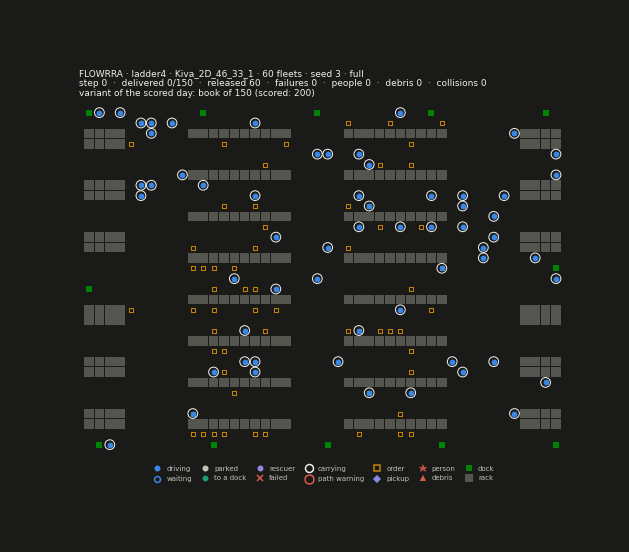
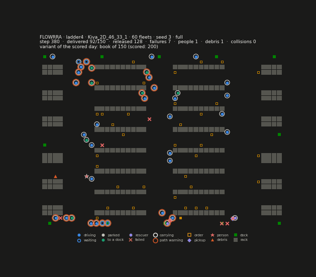

# FLOWRRA Warehouse

**Decentralised coordination for warehouse fleets.** Every fleet (one vehicle) decides locally, from what it perceives within 5 graph hops. The set of all fleets on the floor is treated as one holon that learns to keep itself whole while it works. A learned graph policy and a ladder of path-aware rules share the work, through deliveries, hardware failures and people on the floor, with no central replanning step.

FLOWRRA (Flow Recognition Reconfiguration Agent) is an independent research project by [DhaaRn](https://dhaarn.com). This folder holds its warehouse work.

> **Start here: [`FLOWRRA_Warehouse_V2/`](FLOWRRA_Warehouse_V2/) is the current version.** The full write-up is the article, [`Flowrra_Article.md`](FLOWRRA_Warehouse_V2/Flowrra_Article.md), and every step and run is recorded in the build log, [`V2_The_Conflict_Ladder.md`](FLOWRRA_Warehouse_V2/Journey_in_Writing/V2_The_Conflict_Ladder.md). Everything outside `FLOWRRA_Warehouse_V2/` belongs to the previous version and is kept as a fixed reference point.

---

<div align="center">
  
  <br><sub><b>The whole day.</b> ladder4 on the Kiva-style map: 60 fleets, seed 3, hardware failures and people on the floor. A variant of a scored day, with a book of 150 orders instead of 200: 142 of 150 delivered. Replayed with <code>record_day.py</code> and <code>render_day.py</code>.</sub>
  <br><br>
  
  <br><sub><b>Close-up, every step from 380 to 850 of the same day:</b> fleets yielding, retracing and ordering themselves around failures and people.</sub>
</div>

## Headline result: same floor, different brains (October 2026)

**The test.** FLOWRRA ran against the MAPF planners PIBT and RHCR on the same simulated floor, inside the same safety boundary.

**The safety boundary.** In every system compared, FLOWRRA's included, a fleet is a point on the graph. FLOWRRA adds a boundary around each point, which acts as its footprint:
- a minimum gap of 1 hop;
- warning bubbles of 1.0–1.75 hops;
- braking from 1.5 hops;
- an intent guard that checks every move before anyone moves.

Every arm drove inside that boundary. The planners kept the same world (failures, people, docks, rescues) with FLOWRRA's own decision rules switched off.

**The days**
- **Maps:**
  - three multi-level warehouses from the 3D MAPF warehouse dataset (Wang, Veerapaneni, Wu, Li & Likhachev, ICAPS 2024): `25_5_2_5_2_1`, `25_10_5_10_5_2` and `50_20_5_10_5_2`;
  - a Kiva-style layout made for this project (`Kiva_2D_46_33_1`, 46 × 33 cells).
- **Fleets and seeds:** 20, 40, 60 and 80 fleets; seeds 0–7.
- **Two conditions:** *clean*, and *full* (hardware failures and people clearing debris).
- **Demand:** a book of 100 orders released over 500 steps (200 on the Kiva-style map).
- **In all:** 1,920 arm-days. Every arm meets exactly the same day.

| Arm | Delivered, clean | Delivered, full | Lead time, full (steps) | Near misses with people, full (per day) | Guard stops, full (per day) |
|---|---|---|---|---|---|
| **ladder4** (FLOWRRA champion, route on) | **98.9%** | **87.6%** | 192 | 77.4 | 1,175 |
| ladder6 (network alone, route off) | 94.2% | 82.1% | 234 | 74.7 | 1,138 |
| ladder7 (network alone, route off) | 93.6% | 82.8% | 241 | 61.5 | 1,476 |
| RULES (FLOWRRA's rules, no network) | 95.5% | 87.5% | 191 | 84.0 | 500 |
| PIBT | 98.4% | 79.2% | 188 | **47.2** | **0** |
| RHCR-PP (k = 1) | 94.8% | 86.3% | **165** | 52.4 | 1,284 |
| RHCR-PIBT | 75.2% | 74.6% | 270 | 79.4 | 4,694 |

**What it shows**
- **ladder4 delivered the most of the book in both conditions.**
- **Where coordination is hardest, it delivered firmly more than every planner.** With failures and people at 60–80 fleets:
  - ladder4 90.5%;
  - RHCR-PP 89.1% (paired Wilcoxon, p = 0.003);
  - PIBT 85.3%;
  - RHCR-PIBT 77.5%.
- **The network alone is already a serious option, with little training** (a few hundred episodes).
  - At 60–80 fleets under failures, ladder6 delivered 89.0%, level with the best planner, RHCR-PP at 89.1% (p = 0.54).
  - ladder7 had the highest mean of any arm on the small and medium maps under failures (91.5%, 90.5%).
- **The planners were faster per order and kept further from people.** That is where FLOWRRA has work to do.
- **No arm averaged more than 0.016 collisions a day.**
- **The price of physical operation.** On RHCR's own Kiva map, keeping a safety boundary costs PIBT a factor of 3.1 in throughput: 1.045 goals per timestep under the usual point model, 0.332 inside the boundary (one seed). Results under the point model do not show this cost.

**What we claim, and what we do not.**
- **The claim:** under conditions modelled on real operation, a decentralised holon with a learned policy delivered as much as central planners overall, and more at high density under disruption. That makes decentralised, learned control a serious option for physical fleets.
- **What we do not claim:** that learning beats planning in general.
  - The planners were faster and kept further from people.
  - FLOWRRA's rules alone came within 0.1 points of the champion under disruption.
  - The baselines were implemented from their papers, not the authors' code.
  - Everything here is simulation.

**Data and detail**
- **Per-day results:** [`final_clean.csv`](FLOWRRA_Warehouse_V2/Final_Report/final_clean.csv) and [`final_full.csv`](FLOWRRA_Warehouse_V2/Final_Report/final_full.csv), one row per arm × map × fleet size × seed.
- **Tables and figures:** [`Final_Report/`](FLOWRRA_Warehouse_V2/Final_Report/), made by `final_report.py`.
- **The setup, every measure and the full reasoning:** the article, §5.
- **The predictions written before the run, and how each scored:** the build log, entry 44.

---

## How the brain evolved: from the failure benchmark to the Conflict Ladder

*The failure-shock benchmark, 5 October 2026, before the Conflict Ladder.*

**The benchmark.** Before the redesign, a harder failure benchmark tested recovery:
- 48 paired instances: 2 maps × 25, 40 and 60 vehicles × 8 seeds;
- 9 vehicles killed in 3 waves in every episode.

| small / large map | RHCR-PIBT + nearest-idle recovery | FLOWRRA then (policy + RULES) | RULES alone |
|---|---|---|---|
| Stranded orders recovered | 70.4% / 70.8% | 70.0% / 66.8% | **87.4% / 85.2%** |
| Rescue vehicles lost per episode | 2.67 / 2.62 | 1.50 / 1.71 | **0.25 / 1.08** |
| Orders completed overall | 92.3% / 92.5% | 93.0% / 93.0% | **95.0% / 97.0%** |

**The result.** The rules carried the recovery, and the learned policy of that time did not add value on top of them. A first fix (teacher_run1) did not hold up.

**What came of it.** The redesign was **[The Conflict Ladder](FLOWRRA_Warehouse_V2/Journey_in_Writing/V2_The_Conflict_Ladder.md)**:
- RULES became path-aware rungs;
- a Learner head learns their judgement;
- safety pays by rung;
- values are learned from the moves the system actually made.

In the final test above, the champion delivered 3.4 points more than RULES alone on clean days, and was level with it under failures.

The data for this earlier benchmark is in [`benchmark_new_all_2.csv`](FLOWRRA_Warehouse_V2/Benchmark/benchmark_new_all_2.csv), with figures from [`generate_benchmark_figures_v2.py`](FLOWRRA_Warehouse_V2/reports_during_process/generate_benchmark_figures_v2.py). An earlier training-run comparison, with rolling orders, is in [`COLD_RUN25_ANALYSIS.md`](FLOWRRA_Warehouse_V2/Journey_in_Writing/COLD_RUN25_ANALYSIS.md).

---

## What changed in V2

The full reasoning is in the article (§3) and in V2's design notes.

- **Two environments.** The set of fleets is environment A, a holon whose integrity (0 any collision, 0.5 any warning, 1 clear) sits in every fleet's state. The floor, orders, failures and people are environment B.
- **Decide, guard, move.** Every fleet proposes its move from the same snapshot. Conflicts are grouped into independent components (union-find), and contested ones are resolved jointly by Hungarian assignment with order-invariant tie-breaks. The intent guard checks every landing, then all fleets move at once, at half a hop per step. See [`Simultaneous_Step.md`](FLOWRRA_Warehouse_V2/Journey_in_Writing/Simultaneous_Step.md).
- **The Conflict Ladder.** Rules resolve the conflicts that remain:
  - **L0:** ordering, braking, corridor holds;
  - **L1:** retrace;
  - **L2:** pull over;
  - **L3:** the fundamental recovery tiers (spatial escape, temporal rewind, right-of-way yield).

  Triggers are structural, and each rung has a cost charged to the fleets whose moves made it necessary. See [`V2_The_Conflict_Ladder.md`](FLOWRRA_Warehouse_V2/Journey_in_Writing/V2_The_Conflict_Ladder.md) and [`CONFLICT_DESIGN.md`](FLOWRRA_Warehouse_V2/Journey_in_Writing/CONFLICT_DESIGN.md).
- **Path awareness.** Warnings come from paths that close over an 8-hop route horizon, not from mere proximity. The field carries each fleet's own route ahead and its neighbours' routes. See [`Path_Awareness.md`](FLOWRRA_Warehouse_V2/Journey_in_Writing/Path_Awareness.md).
- **Heads with one job each.**
  - Safety, delivery and efficiency forecast consequences, weighted 6 : 4 : 1 at choice time only.
  - A Learner head learns the system's judgement and acts only as a bounded preference.
  - The recovery head is parked.

  See the article, §3.8.
- **SARSA on the move made.** Each transition waits one step, so values learn from what the system actually did. The whole step goes to the learner as one joint transition. See the article, §3.10.
- **The affordance field and the Gibbs frame:**
  - **How it is now.** The field is A = mask / (1 + R): reachability within 5 graph hops, with spatio-temporal splats (max-stamped, decaying on a fast channel and a slow one with a 32-step half-life) and swept paths of peers. Two Gibbs quantities are measured and in every fleet's state: the local action entropy S, and throughput pressure T = 1 / (1 + orders left / steps left) in the temperature's place.
  - **How we want it to be.** The exponential field P(cell) = exp(−E/T) / Z, with a partition function shared across the floor (log-sum-exp), the global spatial entropy, and F = E − T·S as the objective. It matters most where two fleets can pass side by side.

  See `density_warehouse.py`.
- **Physics and safety.** Speed changes with the situation: slowing in warning zones, braking behind a fleet closing ahead, holding speed on the final approach, picking up again once clear. Failures are modelled on VDA 5050: a failed fleet stops dead and reports an error, and its load is handed over to a rescuer.
- **World fixes (October 2026), applied to every arm:**
  - node snap (a fleet stalled just short of a node);
  - bubble floor (a follower exactly 1 hop behind was braked to a crawl);
  - orphaned orders wait for a pickup.

  See `test_world_fixes.py`.

---

## Folder guide

```
FLOWRRA_Warehouse/
├── FLOWRRA_Warehouse_V2/        the current version
│   ├── Flowrra_Article.md       the article: the whole system and the final test
│   ├── Flowrra_Architecture.html  one step of the system, phase by phase (made by make_ouroboros.py)
│   ├── *.py                     all runnable code, side by side (see the table below)
│   ├── Final_Report/            the final test: per-day CSVs, tables, figures, the two GIFs
│   ├── Journey_in_Writing/      the build log (V2_The_Conflict_Ladder.md) and the design notes
│   ├── ladder_run1/, ladder_run4/, ladder_run6/, ladder_run7/, ...   checkpoints and training metrics, one folder per run
│   ├── all_scens_final/         the final test's scenarios (seeds 0-7 per map)
│   ├── kiva_instances/          lifelong Kiva instances extracted from POGEMA
│   ├── deploy_files/            earlier deploy_eval results
│   ├── Benchmark/               the earlier failure benchmark: data and BENCHMARK.md
│   ├── reports_during_process/  reports, figures and config snapshots from individual runs
│   └── test_files/              the tests
├── FLOWRRA_Benchmark/           previous version's failure benchmark
├── Flowrra_animation.gif / .mp4  previous version's animation
└── *.py, *.csv                  previous-version code and results
```

**The code in `FLOWRRA_Warehouse_V2/`:**

| Area | Files |
|---|---|
| Simulator and policy | `core_warehouse.py`, `node_warehouse.py`, `loop_warehouse.py`, `density_warehouse.py`, `agent_warehouse.py`, `encoder_warehouse.py`, `recovery_warehouse.py`, `proximity_warehouse.py`, `obstacles_warehouse.py`, `guard_warehouse.py` |
| RULES and the ladder | `conflict_warehouse.py`, `corridor_warehouse.py` |
| Configuration | `config_warehouse.py` |
| Training | `main_runner_warehouse.py` |
| The final test | `deploy_eval.py`, `mapf_drivers.py` (PIBT and RHCR as drivers on our floor), `drive_shortest_path.py` (RULES), `final_jobs.py`, `final_report.py`, `record_day.py`, `render_day.py` |
| Earlier benchmarks | `benchmark_all.py`, `benchmark_flowrra.py`, `baselines_mapf.py`, `benchmark_report.py`, `analyse_run.py` |
| Kiva and lifelong | `convert_grid_map.py`, `kiva_instances.py`, `kiva_eval.py`, `run_kiva.py` |
| Scenarios | `generate_scenarios.py`, `check_scenario_overlap.py`, `mapcheck.py` |
| Diagnostics | `check_identity.py`, `lesion_harness.py`, `radius_study.py`, `measure_order_dependence.py`, `profile_step.py`, `profile_phases.py`, `correlate_ray_repulsion.py`, `five_measure_rule.py` |
| The architecture page | `make_ouroboros.py` -> `Flowrra_Architecture.html` |

---

## Running it

Install Python 3 and the dependencies:

```bash
pip install numpy pandas networkx torch scipy matplotlib seaborn plotly pillow
cd FLOWRRA_Warehouse/FLOWRRA_Warehouse_V2
```

Kiva lifelong runs also need `pogema`. It's safest to install it in a separate environment, because it pins numpy 1.26.

**Tests.** Run them from `FLOWRRA_Warehouse_V2/`, so they find the modules beside them. Each test file ends with `ALL PASS`:

```bash
for t in test_files/test_*.py; do PYTHONPATH=. python "$t"; done
```

**Maps and scenarios.**
- The maps aren't stored in this repo. Download the 3D MAPF warehouse dataset (Wang et al., ICAPS 2024), linked from the [mapf.info benchmarks page](https://mapf.info/index.php/Main/Benchmarks), and put each map's nodes and edges CSVs in `all_maps/`.
- The final test's scenarios are in `all_scens_final/`. `generate_scenarios.py` regenerates them, or makes new ones.

**The final test** (240 jobs; about 16 hours on 14 processes):

```bash
python final_jobs.py --list                                    # the jobs, and which are done
nohup python final_jobs.py --run --parallel 14 > final_queue.log 2>&1 &
python final_jobs.py --status
python final_jobs.py --merge                                   # -> final_clean.csv, final_full.csv
python final_report.py --clean final_clean.csv --full final_full.csv --out Final_Report
```

**Replay a scored day.** `--check` confirms the replay is identical to the scored day:

```bash
python record_day.py --arm ladder4 --map Kiva_2D_46_33_1 --fleets 60 --seed 3 --cond full --check Final_Report/final_full.csv
python render_day.py day_ladder4_Kiva_2D_46_33_1_k60_s3_full.json.gz --gif
```

`--book`, `--max-failures` and `--extra-steps` make variants of a day, and every frame's title says so. The GIFs above were made with `--book 150 --extra-steps 600`.

**Training.** Run `python main_runner_warehouse.py --help` to see every option. The commands for each run are in the build log.

**Turning RULES on for earlier configs.** `reports_during_process/config_benchmark_rules.py` is the config snapshot with all six conflict switches on.

**Capacity runs, reports and Kiva.** See [`BENCHMARK.md`](FLOWRRA_Warehouse_V2/Benchmark/BENCHMARK.md).

---

## Roadmap

1. **Federated holons.** Holons that grow and shrink, and rebalance fleets between zones of the floor, keeping each zone at equilibrium, in the spirit of GRAND. Throughput pressure then becomes per zone.
2. **The full Gibbs field:** the exponential field with a shared partition function, the global spatial entropy, and F = E − T·S as the objective.
3. **A learned boundary, then an exact collapse:** exit cells for every fleet in a jam, then a space-time solve between the two boundaries.
4. **A boundary that scales with speed:** from hop scale towards centimetres where that is safe, as real AGVs' speed-dependent safety fields do.
5. **The network alone:** more training for the route-off networks, which already match the best planner at high density under failures.
6. **Lifelong capacity:** the boundary-cost test across seeds, on POGEMA's own instances, with FLOWRRA's networks beside the planners.
7. **The world:** fleets that enter and leave the floor; batteries, with charging served by the same leave-and-return dynamics as the docks; and hardware.

---

## About

FLOWRRA is an independent research project by Rohit Tamidapati ([DhaaRn](https://dhaarn.com)). I designed the system and the experiments, and I built it with heavy AI assistance.

I hold the work to a few practices:
- system design and informational flow;
- policy transformation;
- frozen benchmarks and paired comparisons;
- predictions written down before runs;
- correcting the record in public when a result doesn't hold.

In short, the intuitive one.

I'd love to do this kind of work inside a team facing these problems at scale. If you run a fleet and want to see how FLOWRRA behaves on your layout, or have a view on how it should be tested, I'd like to hear from you through [dhaarn.com](https://dhaarn.com) or [ rohittamidapati@gmail.com ].

**Writing**

- [`Flowrra_Article.md`](FLOWRRA_Warehouse_V2/Flowrra_Article.md) covers the whole system and the final test.
- [FLOWRRA in Warehouse: Evolution towards Harmony](https://rohittamidapati.substack.com/p/flowrra-in-warehouse-evolution-towards) covers V2 before the Conflict Ladder.
- [FLOWRRA: Flow Recognition Reconfiguration Agent](https://open.substack.com/pub/rohittamidapati/p/flowrra-flow-recognition-reconfiguration) covers the concept.

## License

AGPL-3.0. See [LICENSE.md](../LICENSE.md).
